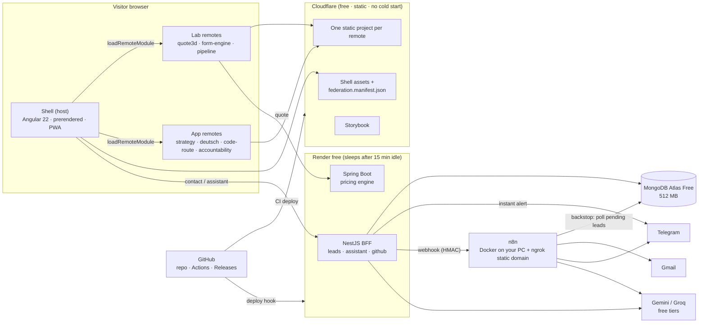
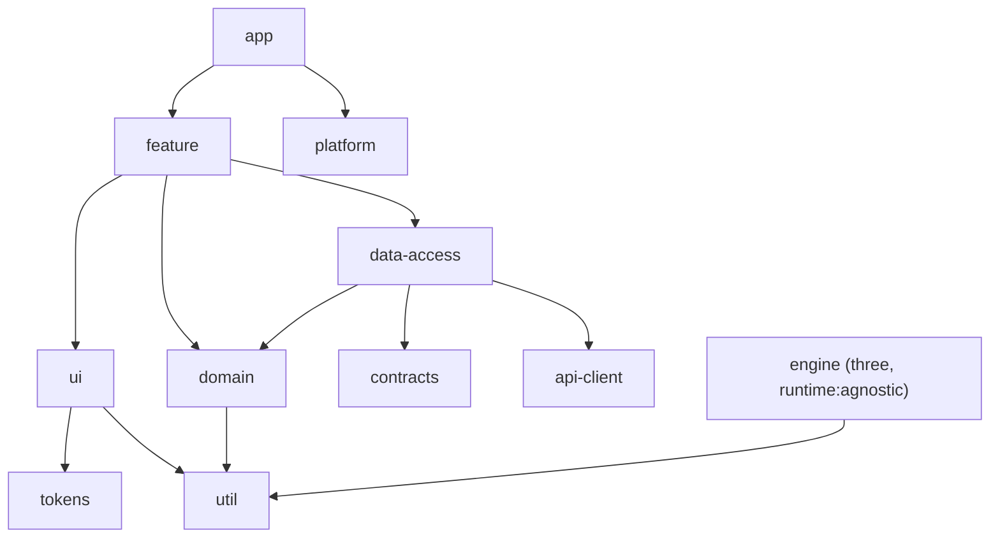
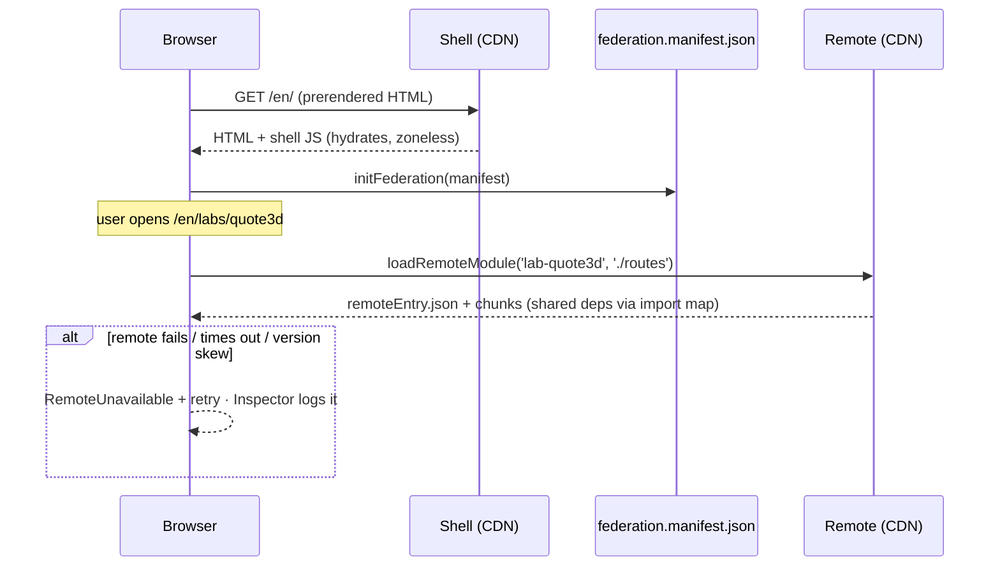
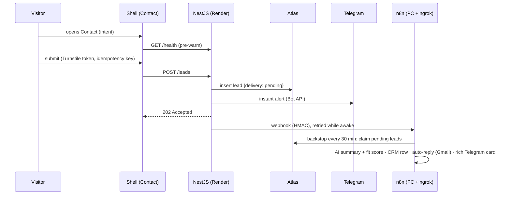

# Ahmed Hrichi — Portfolio Platform Architecture

> Status: **Accepted v1.1** · 2026-10-26 · Repo: `hrichi-platform` · npm scope: `@ah`
> The M0 federation spike is done; its results are in [`docs/adr`](adr/README.md) and override this document where they differ.

---

## 0. TL;DR

**The concept: the portfolio is the proof.** Instead of a page that _lists_ "Angular, Nx, micro-frontends, Three.js, NestJS…", the site _is_ an Nx + Native Federation platform that visitors can open up and inspect. It has three layers:

1. **Portfolio (shell):** a fast, prerendered, SEO-friendly site with three audience modes: recruiter, engineer and client.
2. **Labs (remotes):** clean-room rebuilds of your signature resume work: a 3D instant-quote lab, a schema-driven form engine and an automation pipeline.
3. **Apps (remotes):** your four real apps (StrategyApp, DeutschLernen, Code de la Route, Accountability Architect) running inside the portfolio in demo mode. The same apps ship as desktop builds (Electron) and mobile builds (Capacitor).

**Stack:**

| Area          | Choices                                                                                                     |
| ------------- | ----------------------------------------------------------------------------------------------------------- |
| Frontend      | Angular 22 (zoneless, signals, Signal Forms), NgRx SignalStore with the Events plugin, Native Federation v4 |
| Tooling       | Nx 24                                                                                                       |
| Graphics      | Three.js                                                                                                    |
| Backend       | NestJS, Spring Boot 4, n8n                                                                                  |
| App platforms | Electron, Capacitor/Ionic, PWA                                                                              |

**Cost: $0.** Static assets go on Cloudflare. NestJS and Spring Boot run on Render's free tier, where they sleep when idle. The database is MongoDB Atlas Free. n8n runs on your existing Docker + ngrok setup. CI, desktop builds and APKs go through GitHub Actions and GitHub Releases.

**Golden rule:** _the static site never waits on a backend._ Every dynamic feature degrades gracefully, so free-tier sleep, quota or outage can never make the portfolio look broken.

---

## 1. Goals, audiences, success metrics

| Audience                    | Arrives from              | Needs in < 60 s                                            | Converts by                                       |
| --------------------------- | ------------------------- | ---------------------------------------------------------- | ------------------------------------------------- |
| Recruiter / HR              | LinkedIn, job application | Role, years, stack match, location/remote, CV              | Download CV (EN/FR), email, book a call           |
| Hiring engineer / tech lead | CV link, GitHub           | Proof of architecture depth and code quality               | Read repo and ADRs, open the Federation Inspector |
| Freelance client            | Upwork, Malt, LinkedIn    | "Can he build my thing?", proof, price range, availability | Estimator → brief, book a call                    |

**Audience modes:** a `?for=recruiter|engineer|client` URL parameter (persisted) reorders sections, changes depth and swaps CTAs. Send `…/?for=client` in Upwork proposals and `…/?for=recruiter` in job applications. Analytics then show which channel converts.

**Success metrics**

- Lighthouse: Performance ≥ 95; Accessibility, Best Practices and SEO all 100.
- LCP ≤ 2.0 s on mobile over 4G.
- Shell initial JS ≤ 150 kB gzip.
- M1 shipped and the link in use as early as possible: shipping beats polish.
- Leads per week, CV downloads and booked calls, tracked weekly in the n8n digest.

**Non-goals:** a CMS admin UI (content is code), visitor accounts, paid infrastructure, iOS builds (they need a paid Apple account).

---

## 2. The concept in detail

### 2.1 Portfolio shell (prerendered)

Pages: Home, Experience, Case Studies, Labs, Apps, Services, How I Work, Contact/Estimator, CV (print route), and Architecture (this platform, live).

- **Signature hero:** a 3D _constellation of the real Nx project graph_, exported with `nx graph --file` at build time.
  - Nodes are apps and libs, clusters are products, and edges are real dependencies.
  - Clicking an app node navigates into that remote.
  - LCP stays fast because a poster image of the scene loads first. WebGL loads only after the page is idle, and only on capable devices.
- **Federation Inspector:** an "Open the hood" button in the footer, or `?inspect=1`. It opens a panel that shows:
  - which remotes are loaded, plus each one's version, build SHA and load time
  - shared dependency versions and store snapshots
  - live Web Vitals

  This is the hook for hiring engineers.

### 2.2 Labs: clean-room proof of the resume

| Lab                               | Proves (resume line)                                      | Tech                                                                                                                                                    |
| --------------------------------- | --------------------------------------------------------- | ------------------------------------------------------------------------------------------------------------------------------------------------------- |
| **Quote3D**: instant 3D quote     | SeekMake instant 3D quoting; Three.js custom shaders      | STL parsing in a Web Worker (volume, surface area, bounding box), custom GLSL material, Spring Boot pricing engine with a client-side fallback estimate |
| **Form Engine**: schema-driven UI | Plug-and-play integration platform with JSON-schema forms | JSON Schema → Signal Forms + design-system controls, live schema editor. **The same engine powers the Estimator.**                                      |
| **Pipeline**: automation          | n8n webhook workers, BullMQ, transactional email          | NestJS outbox → n8n, live lead-journey timeline over SSE, replay mode when n8n is offline                                                               |
| **Canvas** (M4): design editor    | MyEasyLogo / MyEasyContent                                | Fabric.js, text-on-arc, undo/redo through a SignalStore history feature                                                                                 |

> ⚠ **Clean-room only.** No SeekMake (or other employer) code, data, screenshots, customer names or branding. Case studies describe employer work at the level of detail your CV already uses.

### 2.3 Apps: your shipped products

| App                                    | Today                                                                     | In the platform             |
| -------------------------------------- | ------------------------------------------------------------------------- | --------------------------- |
| StrategyApp (financial planning)       | Angular 21, SignalStore, Dexie, Firebase, Electron, Nx standalone, GitHub | Remote (demo), desktop, PWA |
| DeutschLernen (SRS flashcards)         | Angular 21, Dexie, Electron, local git only                               | Remote, desktop, **mobile** |
| Code de la Route (TN driving exam)     | Angular 19, zone.js, Tailwind 3, Firebase, Electron, **no git**           | Remote, desktop, **mobile** |
| Accountability Architect (habit pacts) | Angular 22, signals, Electron, GitHub                                     | Remote, desktop             |

**Demo mode:** an `APP_MODE` injection token (`'embedded-demo' | 'standalone'`) swaps providers:

- **`embedded-demo`:** seeded sample data, an isolated IndexedDB name (`ah-demo-<app>`), no Firebase or login, and a "Reset demo" button.
- **`standalone`:** keeps Firebase on the free Spark plan, so the in-progress migration in `VERIFICATION_CHECKLIST.md` still applies.

### 2.4 Conversion layer

- **CV:** generated from the same content as the site, as EN and FR PDFs built in CI. It is never out of sync.
- **Estimator** (clients): a multi-step schema form that returns a rough range and a structured brief, then feeds the lead pipeline.
- **Booking:** embedded Cal.com free plan.
- **Availability badge:** read from `availability.json` ("Open to freelance · Available from Dec 2026").
- **"Ask about Ahmed" assistant** (M4): answers recruiter questions, grounded only in site content, with links to sources.

### 2.5 Skill → proof matrix

| Skill (resume)                | Where a visitor sees it                                              |
| ----------------------------- | -------------------------------------------------------------------- |
| Angular 22, signals, zoneless | Everywhere. Zero `zone.js` in any bundle (CI-enforced).              |
| Nx monorepo                   | The public repo, module boundaries, custom generators, `affected` CI |
| Micro-frontends               | Native Federation shell with 7+ remotes; Federation Inspector        |
| NgRx SignalStore              | Feature stores, cross-remote Events, devtools                        |
| Three.js / shaders            | Constellation hero, Quote3D                                          |
| Design systems                | `@ah/ui`, token pipeline, public Storybook                           |
| NestJS + MongoDB              | Lead outbox, assistant, OpenAPI → generated client                   |
| Java / Spring Boot            | Pricing engine (Spring Boot 4, GraalVM native)                       |
| n8n                           | Lead enrichment, weekly digest, Pipeline lab                         |
| PWA                           | Installable, offline content, Background Sync for the contact form   |
| Electron                      | 4 desktop apps on one shared main-process lib with auto-update       |
| Ionic / Capacitor             | DeutschLernen and Code de la Route on Android                        |
| Testing / CI                  | Vitest, Playwright, axe, Lighthouse CI, visual regression            |
| Schema-driven UI              | Form Engine lab and Estimator                                        |
| Fabric.js                     | Canvas lab                                                           |

---

## 3. System topology



---

## 4. Monorepo

### 4.1 Basics

- **Nx 24.x** integrated monorepo with **pnpm** and a **single version policy**: one root `package.json`, Angular 22.x, TypeScript 6.x and NgRx 22 (ADR-0001).
- **Public GitHub repo** `AHrichi/hrichi-platform`: the code is part of the portfolio.
- **Java** builds with Gradle (Kotlin DSL) through `@nx/gradle`, so `nx affected` covers Spring Boot too.
- **Existing apps** are brought in with `nx import`, which **keeps their git history**.

### 4.2 Layout

```
hrichi-platform/
├── apps/
│   ├── portfolio/
│   │   ├── shell/                    host · prerendered · PWA · dynamic host (manifest)
│   │   └── shell-e2e/                Playwright
│   ├── labs/
│   │   ├── quote3d/                  remote
│   │   ├── form-engine/              remote
│   │   └── pipeline/                 remote
│   ├── products/
│   │   ├── strategy/{web,desktop}
│   │   ├── deutsch/{web,desktop,mobile}
│   │   ├── code-route/{web,desktop,mobile}
│   │   └── accountability/{web,desktop}
│   ├── api/                          NestJS BFF
│   └── pricing-engine/               Spring Boot 4 (Gradle)
├── libs/
│   ├── design-system/
│   │   ├── tokens/                   DTCG JSON → CSS vars + TS constants
│   │   ├── styles/                   cascade layers, reset, typography, utilities
│   │   ├── ui/                       components, one secondary entry point each (@ah/ui/button)
│   │   ├── icons/
│   │   └── motion/                   durations, easings, reduced-motion helpers
│   ├── platform/
│   │   ├── federation/               manifest types, federatedRoute(), error boundary, inspector
│   │   ├── app-mode/                 APP_MODE token, demo/standalone providers
│   │   ├── desktop/                  shared Electron main + typed preload bridge + auto-update
│   │   ├── mobile/                   Capacitor bootstrap, Ionic config
│   │   └── pwa/                      service worker config, Background Sync helper
│   ├── shared/
│   │   ├── content/                  resume.{en,fr}.json, case studies (md), services, availability
│   │   ├── contracts/                DTOs + event groups shared by Angular and Nest (type-only)
│   │   ├── api-client/               generated from OpenAPI (Nest + Spring)
│   │   ├── state/                    cross-remote stores: preferences, federation, lead draft
│   │   ├── i18n/
│   │   ├── seo/                      meta tags, JSON-LD, hreflang
│   │   └── util-*/
│   ├── three/
│   │   ├── engine/                   framework-agnostic (no Angular imports)
│   │   ├── angular/                  <ah-scene> adapter, signals ↔ scene bridge
│   │   └── scenes/{constellation,part-viewer}/
│   ├── portfolio/
│   │   ├── feature-{home,experience,case-studies,services,contact,cv,architecture}/
│   │   ├── data-access-content/
│   │   └── ui-*/
│   ├── labs/<lab>/{feature,domain,data-access,ui}/
│   ├── products/<product>/{domain,data-access,feature-*,ui}/
│   └── api/{leads,assistant,github,health,core}/      Nest modules as libs
├── tools/
│   ├── workspace-plugin/             custom Nx generators (see 4.4)
│   ├── federation/remotes.json       remote registry → per-env manifests
│   ├── n8n/workflows/*.json          version-controlled workflows
│   └── scripts/                      graph export, CV PDF, zone.js guard
├── docs/{architecture.md, adr/}
└── .github/workflows/
```

### 4.3 Tags and module boundaries

Every project carries three tags, enforced in CI by `@nx/enforce-module-boundaries`:

| Axis       | Values                                                                                               |
| ---------- | ---------------------------------------------------------------------------------------------------- |
| `scope:`   | `portfolio`, `lab-<name>`, `product-<name>`, `shared`, `platform`, `design-system`, `api`, `pricing` |
| `type:`    | `app`, `feature`, `ui`, `data-access`, `domain`, `util`, `contracts`, `tokens`, `engine`             |
| `runtime:` | `browser`, `node`, `electron-main`, `jvm`, `agnostic`                                                |



Rules:

- **`ui` libs are presentational.** They never import `data-access`.
- **`domain` libs are pure TypeScript.** No Angular, so they are testable in isolation and reusable in Nest.
- **Isolation between products and labs:** `product-*` and `lab-*` scopes **never import each other**. They may only use `shared`, `platform` and `design-system`.
- **Runtime separation:** `runtime:browser` and `runtime:node` never mix. `contracts` is `runtime:agnostic` and type-only, so Angular and Nest share DTOs with no runtime coupling.
- **Existing apps' own rules still apply inside their scope.** For example, Accountability Architect stays Tailwind-free.

### 4.4 Custom Nx generators (the scaling story)

| Command                                           | Generates                                                                                                                                             |
| ------------------------------------------------- | ----------------------------------------------------------------------------------------------------------------------------------------------------- |
| `nx g @ah/workspace-plugin:remote labs/canvas`    | App with Native Federation remote config, zoneless bootstrap, design-system styles, tags, Cloudflare config, registry entry and Playwright smoke test |
| `nx g @ah/workspace-plugin:ds-component tooltip`  | Component, story, unit test, axe test and secondary entry point                                                                                       |
| `nx g @ah/workspace-plugin:case-study my-project` | Content scaffold with frontmatter                                                                                                                     |

Adding a micro-frontend becomes one command plus its feature code. That makes a strong interview story for platform-team roles.

---

## 5. Frontend architecture

### 5.1 Micro-frontends: Native Federation

**Why Native Federation and not Webpack/Rspack Module Federation:**

- **Nx is dropping its own path:** Nx 23 **deprecated** its Angular Module Federation generators, executors and wrappers, and Nx 24 removes them.
- **Angular's default builder:** Native Federation runs on Angular's esbuild `@angular/build:application` builder, the path Nx points Angular users to.
- **Web standards:** it uses ES modules and import maps.
- **Versioning:** `@angular-architects/native-federation@~22.x` tracks Angular's version.

**Runtime design:**

- **Dynamic host.** The shell reads `/federation.manifest.json` at boot. CI generates one manifest per environment from `tools/federation/remotes.json`.
- **Remote contract.** Every remote exposes exactly:
  - `./routes` → `Routes`
  - `./meta` → `{ id, title, version, buildSha, capabilities: ('webgl' | 'indexeddb' | 'worker')[] }`
- **`federatedRoute()` helper** (in `@ah/platform/federation`). It wraps `loadRemoteModule` with:
  - a timeout
  - a capability check: no WebGL → fallback page
  - telemetry for the Inspector
  - an **error boundary**: on 404, timeout or version mismatch → `RemoteUnavailable` page with retry. The shell keeps working.
- **Shared singletons:** Angular, RxJS, `@ngrx/signals`, `@ah/ui/*` and `@ah/shared/state`. Three.js is shared lazily between labs. The single version policy keeps build-time versions aligned, and a CI check compares each deployed remote's `./meta` version against the shell's to catch drift.
- **Standalone boot.** Every remote also runs on its own, for development and for the products' standalone PWA deployments.



### 5.2 Rendering

- **Content in the shell; interactivity in remotes.** Content routes are prerendered at build time (`@angular/ssr` server routes with `RenderMode.Prerender`) and hydrated with event replay. Federated routes use `RenderMode.Client` and never run on a server.
- **The result:** real HTML for every content page, served from a CDN with **no server at all**. That gives good SEO, an instant LCP and zero cost.
- ✅ **M0 spike passed:** Native Federation v4, prerendering, zoneless, the service worker and a strict CSP work together, with the adjustments recorded in ADR-0002 to ADR-0006 (no federation `ssr` flag, `ngsw.json` regenerated after the federation build, CSP from host headers because `autoCsp` cannot be combined with prerendering).
  - **Fallback if they don't:** prerender with a headless-browser crawl in CI (Playwright saves each route's HTML). This works regardless of the builder.

### 5.3 Zoneless everywhere

- **Bootstrap:** `provideZonelessChangeDetection()` in the shell and in every remote's standalone bootstrap, with no `zone.js` in any polyfills. A CI guard script fails the build if `zone.js` appears in any `package.json` or bundle.
- **Components:** OnPush (Angular 22's default); signal `input()`/`output()`/`model()`; `computed` and `linkedSignal`; `resource` and `httpResource` for async data.
- **Migrating the existing apps:**
  - remove zone.js and `NgZone.run` calls
  - replace `setTimeout`-driven UI updates with signals
  - in tests, use `provideZonelessChangeDetection()` and `await fixture.whenStable()`

### 5.4 State: the ladder (use the lowest rung that works)

1. **Component-local:** `signal`, `computed`, `linkedSignal`.
2. **Feature state:** **NgRx SignalStore**: `withState`, `withComputed`, `withMethods`, `withEntities`, `rxMethod`, and `withHooks` for persistence such as Dexie.
3. **Cross-feature / cross-remote:** the **SignalStore Events plugin** (stable since NgRx 21): `eventGroup`, `withReducer`, `withEffects`, `injectDispatch`.
   - Events are defined in `@ah/shared/contracts`.
   - `@ngrx/signals` is a federation singleton, so an event dispatched inside a remote reaches shell stores with **no import coupling**.
4. **App-wide singletons** in `@ah/shared/state`:
   - `PreferencesStore`: audience mode, locale, theme, reduced motion, 3D quality tier
   - `FederationStore`: feeds the Inspector
   - `LeadDraftStore`: survives navigation and offline use

**Other rules:**

- **Server state:** `httpResource`/`resource` inside stores. No hand-rolled caches.
- **Devtools:** `withDevtools()` from `@angular-architects/ngrx-toolkit`, dev builds only.
- **No classic `@ngrx/store`:** the Events plugin gives the same Redux concepts (events, reducers, effects) on signals with less boilerplate (ADR-005).
- **Existing apps keep their current state approach** unless they need cross-remote events.

### 5.5 Forms

Signal Forms (stable in Angular 22) for all new forms. The Form Engine lib maps JSON Schema → a Signal Forms model + design-system controls, and it is reused by the Estimator and Contact pages. Existing apps migrate forms only when they touch them.

### 5.6 Three.js

- **`@ah/three/engine`** (pure TypeScript, `runtime:agnostic`):
  - renderer lifecycle; resize through a `ResizeObserver`
  - **render on demand**: frames are drawn only while something changes
  - pauses when the scene is off-screen (`IntersectionObserver`) or the tab is hidden
  - **quality tiers** (pixel-ratio cap, shadows, post-processing) chosen by a quick GPU/frame-time probe
  - strict `dispose()`, so route changes never leak GPU memory
- **`@ah/three/angular`:** an `<ah-scene>` component created in `afterNextRender` (browser-only, safe under prerendering). Signals drive scene parameters through `effect()`.
- **Scenes:**
  - `constellation`: the Nx graph, built from instanced meshes with a custom GLSL glow and bloom
  - `part-viewer`: STL loading, a custom material and measurement overlays
- **Workers:** STL parsing, volume (signed tetrahedra) and bounding box run in a Web Worker, with zero-copy transferable `ArrayBuffer`s.
- **Progressive enhancement:**
  - poster image first (it is the LCP)
  - WebGL after `requestIdleCallback`, on capable devices only
  - static SVG graph for `prefers-reduced-motion` or low-tier devices
  - **Three.js is never in the initial bundle**
- **Rendering backends:** WebGL2 is the baseline. A `three/webgpu` + TSL renderer is a later experiment behind a flag.

### 5.7 Internationalization

- **Launch locales:** EN + FR. Arabic (RTL) comes later and costs little, because the design system uses only logical CSS properties.
- **Runtime i18n (Transloco)** with lazy scopes per remote: one build per app instead of one build per locale per remote.
- **Locale lives in the URL** (`/en/…`, `/fr/…`), so both are prerendered and indexed, with `hreflang`.

### 5.8 PWA

- **Shell:** Angular service worker; content routes and design-system assets are precached.
- **Remotes:** cached on first visit. The manifest uses a freshness strategy.
- **Installable.**
- **Contact form:** Background Sync retries a failed submission (Chromium). Other browsers get a retry-with-backoff loop instead.

---

## 6. Design system (`libs/design-system`)

### 6.1 Token pipeline

The source is **W3C DTCG token JSON**, built with **Style Dictionary** into:

- `tokens.css`: CSS custom properties per theme
- `tokens.ts`: typed constants that the **Three.js scenes use**, so 3D colours follow the theme
- theme/splash colours for Electron and Capacitor

Tokens come in three tiers:

1. **Primitive:** `color.crimson.600`, `space.4`, `font.size.300`
2. **Semantic:** `color.bg.surface`, `color.text.muted`, `color.accent.default`, `focus.ring`
3. **Component:** `button.primary.bg`, which references a semantic token

Theming:

- **Themes:** `[data-theme="light|dark|contrast"]` on `<html>`.
- **Density:** `[data-density="comfortable|compact"]`.
- **Brand accent:** your CV's crimson.

### 6.2 Styles

- **Cascade layers:** `@layer reset, tokens, base, layout, components, utilities, overrides;`
- **Typography:** fluid type scale with `clamp()`.
- **Logical properties only** (`margin-inline`, `inset-inline-start`), so RTL comes almost free. stylelint enforces this.
- **Component styles use semantic/component tokens only.** stylelint bans raw hex values and pixel spacing.

### 6.3 Components (`@ah/ui/*`)

- **Behaviour and accessibility:** built on **Angular Aria** (stable in Angular 22) and the CDK. The design system adds the styling and the API.
- **Component rules:** standalone, OnPush, signal inputs, host bindings. One secondary entry point per component, for tree-shaking and clean federation sharing.
- **Starter set:**
  - Actions: Button, IconButton, Link
  - Display: Card, Badge, Tag, Avatar, Skeleton, Timeline, Stat, CodeBlock
  - Navigation: Tabs, SegmentedControl (the audience switch), Stepper
  - Overlays: Dialog, Drawer, Tooltip, Toast
  - Form controls: Input, Textarea, Select/Combobox, Checkbox, Radio, Switch
  - Layout primitives: Stack, Cluster, Grid, Section

  New components are added **only when a page needs one**.

- **Storybook:**
  - public, at `design.<domain>`, with the a11y addon
  - Playwright visual regression on stories whenever the design system changes
  - ⚠ Check Storybook's Angular 22 + zoneless support in M0. Fallback: an in-house docs remote.
- **Adopting it in the existing apps:** tokens first (all four already use CSS variables), components gradually.
  - Accountability Architect keeps raw CSS (its own "no Tailwind" rule).
  - Code de la Route's Tailwind theme reads the tokens until it is replaced.
- **Releases:** versioned with `nx release`. Optionally published to npm as `@ahrichi/ui` (free, and adds credibility).

---

## 7. Backend

### 7.1 NestJS BFF: `apps/api`

| Module (lib)     | Responsibility                                                                                                                                                                                                                                          |
| ---------------- | ------------------------------------------------------------------------------------------------------------------------------------------------------------------------------------------------------------------------------------------------------- |
| `health`         | `GET /health`, used by pre-warm pings                                                                                                                                                                                                                   |
| `leads`          | Contact + Estimator intake (lead pipeline below)                                                                                                                                                                                                        |
| `github`         | Cached GitHub stats for the site (avoids client rate limits)                                                                                                                                                                                            |
| `assistant` (M4) | "Ask about Ahmed" over SSE. Context = compiled site content, small enough to fit the model's context window, so **no vector DB**. Model pool: Gemini → Groq fallback, mirroring your n8n pool. Throttled, Turnstile-gated, refuses off-topic questions. |

**Lead pipeline (`leads`):**

- **Intake:**
  - validates input and verifies Turnstile
  - deduplicates with an **idempotency key**
  - stores the lead as **one MongoDB document that carries its own delivery state** (an atomic single-document write)
- **Instant alert:** sends a Telegram message directly through the Bot API, so the alert never depends on n8n being up.
- **Push:** delivers to the n8n webhook (HMAC-signed), retried with exponential backoff while the API is awake.
- **Pull backstop:** every 30 min, n8n reads pending leads **directly from Atlas** with its MongoDB node and claims them atomically (`findOneAndUpdate`). This neither wakes the API nor spends Render hours.

**Cross-cutting:**

- Helmet, a CORS allowlist, `@nestjs/throttler` and Pino structured logs.
- Config is validated at boot.
- `@nestjs/swagger` produces the OpenAPI spec, which generates `@ah/shared/api-client`.

**Runtime and constraints:**

- **Runtime:** a multi-stage Docker image on Node 24 LTS, hosted on Render free.
- **Email:** Render blocks SMTP ports 25/465/587, so all email goes through n8n's Gmail node, never SMTP from Nest.



### 7.2 Spring Boot pricing engine: `apps/pricing-engine`

- **Platform:** Java 25 LTS, **Spring Boot 4.x**, Gradle Kotlin DSL, `@nx/gradle`.
- **API:** `POST /quotes`
  - **Input:** `{ geometry: { volumeMm3, surfaceMm2, bbox }, process: FDM|SLA|CNC|LASER, material, quantity, currency }`
  - **Output:** a price breakdown covering material, machine time, setup, quantity break and tax.
  - **Rules:** one strategy per manufacturing process.
- **Errors and validation:** Jakarta Bean Validation; Problem Details (RFC 9457) error responses.
- **Contract:** `springdoc-openapi` produces the OpenAPI spec, from which the TypeScript client in `@ah/shared/api-client` is generated.
- **Build:** a **GraalVM native image**, for a small memory footprint and fast cold start on a 512 MB free instance.
  - ⚠ M2 spike. Fallback: the JVM with `-XX:MaxRAMPercentage=75` and class data sharing.
- **Tests:** JUnit 5 and Spring test slices, plus an OpenAPI contract diff in CI.

### 7.3 n8n

Workflows are version-controlled in `tools/n8n/workflows/`, synced like your existing `sync.ps1`:

1. **`lead-intake`:**
   - webhook (HMAC-verified) → AI summary + fit/budget score (Gemini)
   - → CRM row (Google Sheets or Notion)
   - → auto-reply in the visitor's language (Gmail)
   - → a rich Telegram card with Reply/Book buttons
2. **`lead-backstop`:** every 30 min, claims any pending leads in Atlas.
3. **`weekly-digest`:** visits (Cloudflare Analytics API), leads and CV downloads, sent to Telegram.
4. **`pipeline-lab-demo`:** a safe public demo for the Pipeline lab (no personal data).

**Hosting:** your current Docker + ngrok static domain. Thanks to the outbox and the backstop, **n8n can be offline without losing a single lead**. Moving it to an always-on host later only changes one URL.

---

## 8. Platforms: one feature lib, many shells

```
libs/products/deutsch/feature-flashcards
   ├─► apps/products/deutsch/web      Native Federation remote in the portfolio + standalone PWA
   ├─► apps/products/deutsch/desktop  Electron (@ah/platform/desktop)
   └─► apps/products/deutsch/mobile   Capacitor Android (Ionic components in the mobile shell only)
```

- **`@ah/platform/desktop`** replaces the four copies of `main.js` with one lib:
  - window-state persistence, tray, single-instance lock
  - `contextIsolation` + sandbox
  - a **typed preload bridge** (contract types live in `contracts`)
  - native notifications
  - `electron-updater` against GitHub Releases
- **Mobile:** Capacitor, current major. APKs go to GitHub Releases; the Play Store costs a one-time fee, so it is optional later. iOS is out of scope.
- **Release pipeline:**
  - the GitHub Actions matrix (Windows + Ubuntu) runs `electron-builder` on tags
  - the Apps page reads the latest release assets at build time and shows "Download for Windows / Linux / Android" buttons

---

## 9. Content & SEO

- **Single source:** `libs/shared/content/`
  - `resume.{en,fr}.json`: JSON Resume schema plus extensions (metrics, links, case-study refs, audience tags)
  - `case-studies/*.md`: frontmatter with title, role, stack, metrics and audience
  - `services.json` and `availability.json`
- **Compiled at build time** (an Nx `content:build` target): Markdown → HTML, Shiki code highlighting and Mermaid → SVG all happen at build time. **Zero runtime parsing.**
- **One source, many outputs:**
  - site pages
  - **CV PDFs** (EN/FR): Playwright prints `/cv/print` in CI
  - JSON-LD (`Person`, `ProfilePage`, `CreativeWork`)
  - `sitemap.xml`, `robots.txt`, and per-page Open Graph images
  - the assistant's context
- **Case-study template:** Context → Problem → My role → Architecture (diagram) → Decisions & trade-offs → Outcome (metrics) → Stack.

---

## 10. Zero-cost deployment

| Piece                     | Where                                                                     | Free limits that matter                                                                       | Risk                       | Fallback                                                                     |
| ------------------------- | ------------------------------------------------------------------------- | --------------------------------------------------------------------------------------------- | -------------------------- | ---------------------------------------------------------------------------- |
| Shell, remotes, Storybook | **Cloudflare static assets** (one project per deployable)                 | Static requests free and unlimited                                                            | None for static            | GitHub Pages mirror                                                          |
| NestJS API                | **Render free** (Docker)                                                  | 750 instance-h/month **per workspace**; sleeps after 15 min; no persistent disk; SMTP blocked | ~1 min cold start          | Pre-warm on intent, honest "waking" UI, Background Sync, `mailto:` + Cal.com |
| Pricing engine            | **Render free** (shares the 750 h)                                        | As above                                                                                      | Cold start                 | Client-side estimate badged "approximate"                                    |
| Database                  | **MongoDB Atlas Free**                                                    | 512 MB, one free cluster per project                                                          | —                          | —                                                                            |
| Automation                | **n8n** on your PC (Docker + ngrok static domain)                         | Free                                                                                          | Offline when the PC is off | Outbox + 30-min backstop; direct Telegram alert                              |
| AI                        | **Gemini / Groq** free tiers                                              | Rate limits                                                                                   | Quota exhaustion           | Canned FAQ answers                                                           |
| Bot protection            | **Cloudflare Turnstile**                                                  | Free                                                                                          | —                          | —                                                                            |
| Analytics                 | **Cloudflare Web Analytics**                                              | Free, cookieless (no consent banner)                                                          | —                          | —                                                                            |
| Errors                    | **Sentry** Developer plan                                                 | Free quota                                                                                    | —                          | Logs                                                                         |
| Booking                   | **Cal.com** free                                                          | —                                                                                             | —                          | `mailto:`                                                                    |
| CI / binaries             | **GitHub Actions + Releases**                                             | Free on public repos                                                                          | —                          | —                                                                            |
| Domain                    | `*.workers.dev` now; apply for **`ahmed.is-a.dev`** (free, via GitHub PR) | —                                                                                             | —                          | Optional later: ~$12/yr `.dev`                                               |

**Pre-warming:** the shell pings `/health` only when a visitor shows intent: they enter Contact, the Estimator or a lab, focus a form, or hover a CTA. There are **no 24/7 keep-alive pings**, because Render's 750 hours are shared by Nest and Spring Boot. While a service wakes, the UI says honestly that it's "waking the free-tier server…". That honesty is itself a signal of engineering judgment.

**Deploy mechanics:**

- Each Cloudflare target has its own `wrangler` config.
- **`nx affected -t deploy`** redeploys only the remotes that changed.
- Hashed assets are `immutable`; `remoteEntry.json` and `federation.manifest.json` are `no-cache`.
- CORS headers on remotes allow the shell's origin.

**Security headers:** CSP, HSTS, `X-Content-Type-Options`, `Referrer-Policy` and `Permissions-Policy`.

- ✅ Verified policy in ADR-0006: hashed inline scripts plus `blob:` (es-module-shims runs modules from blob URLs) and the remote origins. Angular's `autoCsp` cannot be used with prerendering, so `tools/scripts/prepare-hosting.mjs` writes the header on every deploy (ADR-0007).

**Secrets** live in GitHub Actions secrets and Render env vars, never in the repo. Each app has a `.env.example`.

---

## 11. CI/CD & quality gates

| Trigger            | Runs                                                                                                                                                                                                                        |
| ------------------ | --------------------------------------------------------------------------------------------------------------------------------------------------------------------------------------------------------------------------- |
| Pull request       | `nx affected -t lint typecheck test build` · module boundaries · zone.js guard · bundle budgets · Playwright smoke on affected apps · Lighthouse CI on the shell preview · visual regression when the design system changes |
| Push to `main`     | Deploy affected Cloudflare projects · Render deploy hooks · Spring image → GHCR · regenerate manifests · rebuild CV PDFs                                                                                                    |
| Tag (`nx release`) | Electron + Android builds → GitHub Releases · changelogs from conventional commits                                                                                                                                          |

**Testing pyramid:**

| Level         | Tools                                                              |
| ------------- | ------------------------------------------------------------------ |
| Unit          | Vitest (Angular and Nest), JUnit 5 (Spring)                        |
| Component     | Angular Testing Library                                            |
| End-to-end    | Playwright, including a federation smoke test against preview URLs |
| Accessibility | axe in Playwright and Storybook                                    |
| Visual        | Playwright screenshots of Storybook stories                        |
| Performance   | Lighthouse CI                                                      |
| Contract      | OpenAPI diff                                                       |

**Tooling:**

- ESLint flat config with angular-eslint, plus stylelint and Prettier.
- commitlint and lefthook for commit conventions and git hooks.
- Nx local cache with GitHub Actions cache. The free Nx Cloud Hobby plan is optional.

**Performance budgets (CI fails if exceeded):**

| Metric                            | Budget        |
| --------------------------------- | ------------- |
| Shell initial JS                  | ≤ 150 kB gzip |
| Remote entry chunk (excl. shared) | ≤ 120 kB gzip |
| LCP (mobile, 4G)                  | ≤ 2.0 s       |
| CLS                               | ≤ 0.05        |
| INP                               | ≤ 150 ms      |
| Three.js in the initial bundle    | Never         |

---

## 12. Observability (free)

- **Cloudflare Web Analytics** for traffic and Core Web Vitals. It is cookieless.
- **Sentry**, browser and Nest. Errors are tagged with the remote id and version.
- **Pino** JSON logs, viewed in Render's log viewer.
- **The Federation Inspector** in the app, for live architecture introspection.

---

## 13. Migrating the four existing apps

The order goes from easiest to hardest:

| #   | App                      | Work                                                                                                                                           |
| --- | ------------------------ | ---------------------------------------------------------------------------------------------------------------------------------------------- |
| 1   | Accountability Architect | Already Angular 22 · `nx import` · extract libs · remote + demo mode                                                                           |
| 2   | DeutschLernen            | 21 → 22 · add a GitHub remote first · `nx import`                                                                                              |
| 3   | StrategyApp              | 21 → 22 · zone.js → zoneless · Karma → Vitest · already Nx standalone · `nx import`                                                            |
| 4   | Code de la Route         | `git init` first · 19 → 20 → 21 → 22 one major at a time · `@ngrx/signals` 18 → 22 · zone.js → zoneless · Karma → Vitest · Tailwind 3 → tokens |

**Per-app checklist:**

1. Upgrade to Angular 22 **in its own repo** (`ng update`, one major at a time) and get the tests green.
2. `nx import` into `apps/products/<name>/web`. Git history is kept.
3. Go zoneless and fix change-detection assumptions.
4. Extract libs in order: `domain` → `data-access` → `feature` → `ui`, then tag them.
5. Add the Native Federation remote config (`./routes`, `./meta`), the demo-mode providers and seed data.
6. Replace `main.js` with `@ah/platform/desktop`.
7. Adopt design-system tokens, then components over time.
8. Wire up the CI deploy and release.

---

## 14. Roadmap

Each milestone ships on its own. **M1 is the one that gets you interviews, so it comes before anything fancy.**

| Milestone                   | Scope                                                                                                                                                          | Exit criteria                                                                                                                                  |
| --------------------------- | -------------------------------------------------------------------------------------------------------------------------------------------------------------- | ---------------------------------------------------------------------------------------------------------------------------------------------- |
| **M0 Foundation**           | Workspace, pnpm, lint/format, boundaries, CI skeleton, design-system tokens v0, shell + 1 hello remote, Nest `/health`                                         | Shell + remote live on Cloudflare via CI · Native Federation + zoneless + prerender + PWA + CSP spike recorded as ADRs · zone.js guard passing |
| **M1 Launchable portfolio** | Home, Experience, 3 case studies, Services, Contact (full lead pipeline), CV PDF (EN), audience modes, SEO, poster-image hero                                  | Lighthouse budgets green · a test lead reaches Telegram + n8n · **start sending the link**                                                     |
| **M2 Signature**            | Three.js engine, constellation hero, Quote3D lab + Spring Boot pricing engine, Federation Inspector, public Storybook                                          | WebGL scenes pass budgets and the reduced-motion fallback                                                                                      |
| **M3 Products**             | Import the 4 apps (order in §13), demo-mode remotes, shared Electron lib, GitHub Releases downloads                                                            | All 4 apps run inside the portfolio and as desktop builds                                                                                      |
| **M4 Differentiators**      | Form Engine lab + Estimator, Pipeline lab, assistant, FR locale + FR CV, Capacitor Android (DeutschLernen, Code de la Route), custom Nx generators, Canvas lab | Each ships as an independent remote                                                                                                            |

---

## 15. Risks

| Risk                                                          | Mitigation                                                                                                  |
| ------------------------------------------------------------- | ----------------------------------------------------------------------------------------------------------- |
| Over-building and never launching                             | M1 ships without 3D or the apps; every later feature is a remote that ships alone                           |
| Native Federation + prerender + CSP friction                  | M0 spike; headless-browser prerender fallback; CSP nonce/hashes                                             |
| Free tiers change (several did in 2026)                       | Static-first; backends are plain containers behind one URL env var; GitHub Pages mirror for the static site |
| Render's 750 h are shared                                     | No keep-alive pings; intent-based pre-warm; n8n backstop reads Atlas directly                               |
| Cold-start UX                                                 | Honest waking state, client fallbacks, Background Sync                                                      |
| Employer IP                                                   | Clean-room labs only; no employer code, data or branding                                                    |
| Shared-dependency skew between independently deployed remotes | Single version policy + CI check of deployed `./meta` versions + Inspector warning                          |
| Assistant hallucination or abuse                              | Content-only grounding, refusal policy, Turnstile + throttling, ships in M4 only                            |
| Design-system scope creep                                     | Starter set only; new components only on demand                                                             |

---

## 16. Decision log

The full records are in [`docs/adr`](adr/README.md). Proposed decisions get the next number when their area is built.

| ADR                                         | Decision                                                                                         | Status   |
| ------------------------------------------- | ------------------------------------------------------------------------------------------------ | -------- |
| [0001](adr/0001-nx-integrated-monorepo.md)  | Nx 24 integrated monorepo · pnpm · single version policy                                         | Accepted |
| [0002](adr/0002-native-federation.md)       | Native Federation v4 · dynamic host · remote contract `./routes` + `./meta`                      | Accepted |
| [0003](adr/0003-static-first-rendering.md)  | Prerendered shell; client-rendered remotes; no server                                            | Accepted |
| [0004](adr/0004-zoneless.md)                | Zoneless everywhere; `pnpm check:zoneless` guard                                                 | Accepted |
| [0005](adr/0005-pwa-with-federation.md)     | Service worker regenerated after the federation build                                            | Accepted |
| [0006](adr/0006-content-security-policy.md) | CSP header with build-time hashes                                                                | Accepted |
| [0007](adr/0007-cloudflare-hosting.md)      | Cloudflare Workers static assets, one Worker per app, affected deploys from CI                   | Accepted |
| —                                           | State ladder: signals → SignalStore → Events plugin; no classic `@ngrx/store`                    | Proposed |
| —                                           | Design tokens in DTCG + Style Dictionary; cascade layers; logical properties; Angular Aria + CDK | Proposed |
| —                                           | Framework-agnostic Three.js engine + thin Angular adapter; progressive enhancement               | Proposed |
| —                                           | Zero-cost topology: static-first; sleeping backends; graceful degradation                        | Proposed |
| —                                           | Lead pipeline: document outbox + direct Telegram alert + n8n push/pull                           | Proposed |
| —                                           | Single-source content → site, CV PDF, JSON-LD, assistant                                         | Proposed |
| —                                           | One feature lib, many shells (remote / PWA / Electron / Capacitor)                               | Proposed |
| —                                           | OpenAPI contract-first; generated TS clients for Nest and Spring                                 | Proposed |
| —                                           | Runtime i18n (Transloco), EN/FR, URL-based locale, RTL-ready                                     | Proposed |

---

## 17. Open questions for Ahmed

1. **Public repo?** Recommended: yes. The code is part of the portfolio.
2. **Domain:** a free `ahmed.is-a.dev`, or buy a domain later (the only optional spend)?
3. **Recruiter mode facts:** remote only, or open to relocation? Which regions (EU / Gulf / North America)? Work authorization line?
4. **Languages:** EN + FR at launch, Arabic later. OK?
5. **Classic `@ngrx/store`:** some enterprise job posts still ask for it. The recommendation is no; the Events plugin covers the same concepts. Do you want one example anyway?

---

## Sources (checked 2026-10-26)

- Nx: Angular Module Federation deprecated in v23, Native Federation path: <https://nx.dev/docs/kb/migrate-angular-module-federation>
- Nx 23.1 (Angular 22, TS 6 support): <https://nx.dev/blog/nx-23-1-release>
- Native Federation package: <https://www.npmjs.com/package/@angular-architects/native-federation>
- Native Federation SSR & hydration: <https://www.angulararchitects.io/blog/ssr-and-hydration-with-native-federation-for-angular/>
- Angular v22 (Signal Forms, Angular Aria, resource APIs stable): <https://angular.dev/events/v22>
- NgRx 22: <https://www.infoq.com/news/2026/10/ngrx-22-angular/> · Events plugin: <https://ngrx.io/guide/signals/signal-store/events>
- Render free tier: <https://render.com/docs/free>
- Cloudflare static assets billing: <https://developers.cloudflare.com/workers/static-assets/billing-and-limitations/>
- MongoDB Atlas free cluster limits: <https://mongodb.com/docs/atlas/reference/free-shared-limitations/>
- Spring Boot 4.x line: <https://spring.io/blog/2026/06/25/spring-boot-3-5-16-available-now/>
- Free-hosting changes in 2026: <https://snapdeploy.dev/state-of-free-hosting>
- is-a.dev: <https://github.com/is-a-dev/register>
