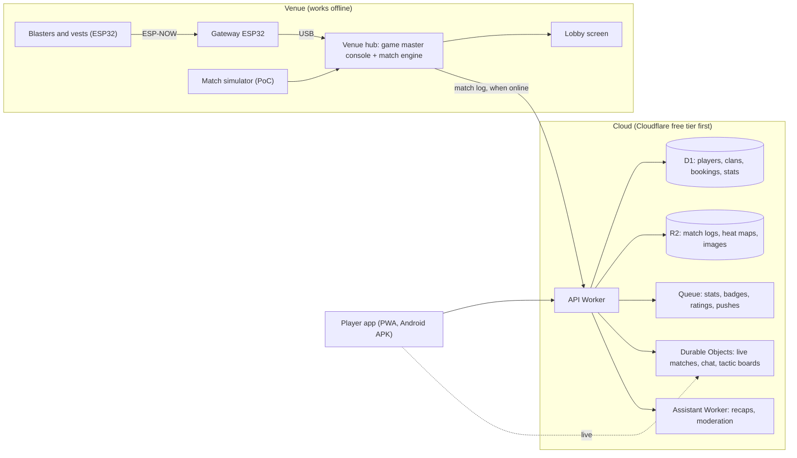

# Laser tag player app: proof-of-concept plan

> **Status: Accepted 2026-11-27 with the owner's answers (§7); P1 in progress.** Decisions: [ADR-0033](../adr/0033-barq-laser-tag.md).
> Brand: **BARQ** (برق, "lightning", §0.1). Code slug: `lasertag`, so a later rename only touches copy.
> The money, market and legal side is a private business case, kept on the owner's machine and out of this public repo. The Project Workbench plan (`docs/project-workbench-plan` branch) is parked: the owner chose to build the laser tag first.

## 0. In one paragraph

A player app and venue system for a laser tag business. Players get a profile and a QR badge, play matches whose every shot, tag, infection and step is recorded, and come back for ranks, badges, seasons, clans, themed events and challenges with friends. Venues get check-in by QR, gear assignment, sessions and bookings, coupons, themes and a lobby screen. Guests can play without an account and claim their stats later. The proof of concept runs without hardware: a **match simulator** produces the same events the blasters and vests will send, so the whole loop can be built, tested and shown now. One map at launch; venues, maps and countries are in the data model from day one.

### 0.1 The brand: BARQ

**BARQ** (برق) means lightning: the flash of a shot, and speed (Tunisians say _kif el barq_, "like lightning"). It is one short word that reads the same in Arabic, French and English, belongs to light rather than to weapons (useful while the gear's legal status is checked), and gives an obvious mark: a lightning bolt.

| Language | Name | Tagline               |
| -------- | ---- | --------------------- |
| Arabic   | برق  | كيف البرق             |
| French   | BARQ | Rapide comme l'éclair |
| English  | BARQ | Strike like lightning |

A quick search found no laser tag or arena brand called Barq in Tunisia. Before printing anything, register the mark with INNORPI (classes 9, 28 and 41) and check the domain names; abroad, "Barq's" is a root beer, a different class.

## 1. What the PoC must prove

1. **The loop works end to end:** book → check in with QR → play → stats within a minute → leaderboard and badges → a reason to come back.
2. **Guests convert:** a guest plays, sees their stats, and can claim them into an account in a few taps.
3. **The data model scales:** many venues, maps, countries, languages and seasons, without a rewrite.
4. **It's demoable to a venue partner or investor**, on a phone, in Arabic, French or English.

What the PoC does **not** need yet: real payments, voice chat, real hardware, iOS store builds.

## 2. Roles

| Role                | Can                                                                                        |
| ------------------- | ------------------------------------------------------------------------------------------ |
| Guest player        | Play with a nickname only; gets a guest QR and claim code; stats kept 30 days for claiming |
| Player              | Profile, QR badge, stats, ranks, badges, friends, clans, bookings, challenges              |
| Guardian            | Consents for a minor, manages the child's privacy, sees their stats                        |
| Game master (staff) | Check-in, gear pairing, start and stop matches, choose mode, theme and weapons, live view  |
| Venue manager       | Sessions and prices, coupons, themes, maps, gear, reports                                  |
| Platform admin      | Venues, global seasons, badges, moderation                                                 |
| Lobby screen        | Live scoreboard and kill feed on a TV, no login                                            |

## 3. Features

Each feature is tagged **PoC** (built in the proof of concept), **MVP** (needed before selling) or **Later**.

### 3.1 Identity, QR badge and guests

- **Player QR (PoC):** the app shows a QR that changes every 30 seconds (a signed token), so a screenshot can't be reused by someone else to play under your name. A printed card or wristband carries a fixed id, which staff check against the name on screen.
- **Guest check-in (PoC):** staff type a nickname (no personal data). The guest gets a QR on screen or on paper with a claim code. After the match: "Your stats are waiting: claim them" (sign up, scan, done). A claim waits until the guest has played: while they still wear gear it is refused, in words. Unclaimed guests are deleted after 30 days.
- **Gear pairing (PoC):** every blaster and vest has its own QR sticker. Check-in is two scans: player, then vest (the blaster is paired to the vest). The gear only knows its own id; the venue hub maps gear to player for the session, so no personal data goes onto the gear.
- **Sign-in (PoC):** passkeys only (the owner's choice): no passwords, no email, no SMS cost. A passkey syncs through the phone's own password manager (Google, Apple, Samsung), so a new phone of the same account still works. A player who loses every device gets a one-time recovery QR from staff at the venue, after staff check who they are.
- **Minors (PoC):** the birth year is asked at sign-up. The owner chose **a guardian for under-13s**: in P1 an under-13 can't sign up alone and plays as a guest until the guardian flow (P6) exists. Players under 18 get the minor defaults: private profile, chat off, no photo, only the nickname on leaderboards (§4.6). The age is a per-country setting, because:
  - **Launch blocker, for a lawyer:** Tunisia's law 2004-63 (article 28) allows processing a child's data only with the guardian's consent **and** the family judge's authorisation, and a child is anyone under 18. Under-13 consent alone does not meet that. Before real players sign up, a lawyer confirms what the venue must do (likely guardian consent up to 18, and the judge's part), and the setting follows.
- **NFC wristbands (Later):** a tap instead of a scan, for busy venues.

### 3.2 Stats

**Per match (PoC), from the event log:**

- Shooting: shots fired, hits, accuracy, tags (kills), times tagged (deaths), K/D, assists.
- Where hits land: head, front, back, shoulders (the vest's sensors); headshots.
- Survival: longest streak, time alive, respawns.
- Mode-specific: infections spread and time survived as a human, flags captured and returned, base time held, power-ups used, healing done.
- Context: weapon, team, map, mode, theme, duration, venue.
- Result: score, place, MVP, XP gained, rating change.
- Movement: distance moved, a **heat map**, and a **nemesis** (who tagged you most) and **victim** (who you tagged most).

**Career (PoC):** totals and per-minute averages, split by mode, map, weapon and season.

- Time played, matches, wins, win rate.
- Skill rating per mode family.
- Favourite weapon and map; best match; nemesis of all time.
- Level, badges, season history, clan history (transfers).

**Heat map:** positions on a grid of the map (1 m cells), per player and match, and summed over a season.

- The player sees their own. The clan sees members' heat maps, if the member agrees. The venue sees totals (dead corners, choke points) to improve the map. Nothing about positions is public.
- In the PoC, positions come from the simulator. With hardware, positions first come from **zone beacons** (which room or zone you're in). Precise positions (Wi-Fi FTM, about 1–3 m indoors; or UWB, under 0.5 m but costlier) come later, if venues want them.

### 3.3 Engagement: why players come back

Free Fire and similar games keep players with seasons, ranks, events, clans, daily goals and constant small rewards. We use those, **without the mechanics that backfire with this audience**: paid loot boxes, pay-to-win, paid virtual currency, fake countdowns, shaming for lost streaks. Parents pay for most sessions, Tunisian law is strict on children's data, and the European Commission proposed this month to ban paid loot boxes and pay-to-win for minors (the private business case). The loop is built around the 60 seconds after a match, when players are most excited:

| Moment         | What the app does                                                                                                                                                                                          | Tag   |
| -------------- | ---------------------------------------------------------------------------------------------------------------------------------------------------------------------------------------------------------- | ----- |
| Right after    | **Match summary** pushed to every phone: place, MVP, awards ("Sharpshooter", "Unkillable", "Medic hero", "First blood", "Revenge"), XP bar filling, level-up, new badges, rating change, heat map, nemesis | PoC   |
| Right after    | **Share card**: an image with your stats in the app's look, made for Instagram, TikTok and WhatsApp stories. Stats only, never a photo of a minor                                                          | PoC   |
| Right after    | **Player card**: a collectible card with an overall rating and five attributes (Accuracy, Survival, Teamwork, Aggression, Objective) that change as you play                                               | PoC   |
| Between visits | **Levels and XP**; **badges** in bronze, silver and gold; **mastery** per weapon and mode                                                                                                                  | PoC   |
| Between visits | **Leaderboards** by venue, country, clan and friends; weekly, season and all time. Weekly boards reset, so a newcomer can top something. "Top 12 % this week"                                              | PoC   |
| Between visits | **Weekly challenges** ("win 3 infection rounds", "60 % accuracy in one match") and a **weekly streak** with one free miss                                                                                  | PoC   |
| Between visits | **Seasons** (about 8–10 weeks): a ladder from Bronze to Legend, season badges, a free reward track earned by playing                                                                                       | MVP   |
| Between visits | **Rivals**: "Your nemesis booked Saturday 5 pm" (only if both are friends or in clans, and opted in)                                                                                                       | MVP   |
| Between visits | **Clan progress**: clan level, clan wars, clan leaderboard                                                                                                                                                 | PoC   |
| Between visits | **Referrals**: invite a friend, both get a free game or XP boost                                                                                                                                           | MVP   |
| Between visits | **Themed events** with limited badges (§3.8)                                                                                                                                                               | PoC   |
| Between visits | **Physical rewards**: a patch or wristband at level 10, 25, 50                                                                                                                                             | Later |
| Notifications  | At most one a day, never at night, each type can be turned off; quiet hours by default for minors                                                                                                          | PoC   |

### 3.4 Game modes and weapons

- **Modes in the data model (PoC):** team deathmatch, free-for-all, infection (zombies), capture the flag, domination, VIP escort, gun game (your weapon changes with every tag), elimination rounds, last stand (players against a staff "boss" in waves).
- **The simulator runs three in the PoC:** team deathmatch, free-for-all and infection.
- **Weapon profiles (PoC):** class (pistol, SMG, rifle, sniper, shotgun), damage, fire rate, magazine, reload time, **range** and **precision** (beam spread), plus the level that unlocks it. The simulator turns range and spread into hit chances.
- **Weapons on the real gear (Later):** a weapon has two halves:
  - Software: the profile, sent to the blaster for the match.
  - Hardware: the IR power (range) and the lens or barrel (precision). A sniper has a narrow lens and high power; a shotgun several wide LEDs.
- **Unlocks are sidegrades, not upgrades:** a sniper trades fire rate for range, so a newcomer with the starter rifle isn't outgunned. Weapons are never sold.
- **Roles (MVP):** medic (heals teammates by IR), scout (radar ping), heavy (more health, slower).
- **Power-up pods (Later):** shield, double damage, ammo, respawn, triggered by IR or RFID stations on the map.

### 3.5 Teams, clans and transfers

- **Match teams (PoC):** set per match by the game master, or balanced automatically from skill ratings (OpenSkill, MIT).
- **Parties (MVP):** friends who book and queue together.
- **Clans (PoC):**
  - Name, tag `[ABC]`, emblem, motto and home venue.
  - Roles: leader, officers, members, recruits.
  - Clan XP and level, clan leaderboard.
  - A recruitment board: "looking for clan" and "looking for players".
- **Transfers (PoC):** the rules that make a "transfer market" fair:
  - A player asks to join; the new clan accepts. Or a clan invites; the player accepts. Leaving needs no approval.
  - **Transfer windows:** between seasons, plus one mid-season window. Outside them a player can leave but not join another clan.
  - **Cooldown** of 7 days after leaving, and rosters lock for a tournament.
  - Every move is kept in the player's **career history** ("Played for [ABC] Season 1–2, [XYZ] Season 3"). No money is involved.
- **Clan wars (MVP):** one clan challenges another, both pick a slot, and the result counts on the clan leaderboard (§3.7).

### 3.6 Meetings

- **Clan room (PoC):** text chat. Messages are checked for abuse; anyone can report one; nothing for under-16s unless a guardian allows it.
- **Meetings (PoC):** a scheduled meeting with an agenda and RSVP, and a **tactic board**: the map with markers, arrows and zones that everyone in the meeting sees move live.
- **Voice (MVP):** WebRTC through Cloudflare Realtime, free for the first 1,000 GB of traffic a month. Adults only by default.

### 3.7 Sessions, bookings and fights

- **Venue calendar (PoC):** slots with a type and capacity, which is the number of gear sets.
- **Session types (PoC):**
  - Open play: individuals join and the system fills the teams.
  - Private: a group books the whole slot.
  - Packages: birthday, corporate team building, school trip, league night, clan war.
- **Booking (PoC):**
  1. Pick a day and slot, then the party size.
  2. Invite friends or the clan.
  3. Apply a coupon.
  4. Confirm. The confirmation is a QR, followed by a reminder.
     Payment on site in the PoC; online with Flouci or Konnect in the MVP.
- **Waitlist and cancellation rules (MVP).**
- **Schedule a fight (PoC):**
  1. A clan or party challenges another and proposes slots.
  2. The other side accepts one, and the booking is made for both.
  3. The result feeds both sides' records.
- **Leagues and tournaments (Later):** brackets within a venue, then national finals between venues.

### 3.8 Themes

- **A theme (PoC) is data:** name, dates, the app's look (a design-system look, like SerraCalc's `desert`), the gear's LED colours, the announcer's sound pack, featured modes, limited badges and linked coupons.
- **Starter themes:**
  - Halloween: infection night, with zombie green.
  - New Year: countdown matches.
  - Summer.
  - Ramadan nights: late sessions after iftar.
  - Eid.
  - Back to school.
  - Big football tournaments: team colours.
- **Themes switch on and off by date.** A venue can add its own.

### 3.9 Coupons

- **Types (PoC):** percent off, fixed amount off, a free game, a package upgrade.
- **Rules (PoC):**
  - Dates and times (off-peak), session types, venue.
  - Minimum party size; first visit only.
  - Uses in total and per player; whether it stacks.
- **Special kinds:**
  - Birthday codes.
  - Referral codes, one per player (MVP).
  - Clan codes.
  - Win-back codes for players who stopped coming (Later).
- **Safety:** checked on the server only; codes are long enough not to be guessed; tries per minute are limited; every redemption is logged.

### 3.10 Venue tools

- **Game master console (PoC):** today's sessions, check-in, gear pairing, the match setup (map, mode, theme, weapons, teams), start, pause and stop, a live scoreboard, and gear battery and faults.
- **Lobby screen (PoC):** a TV showing the live scoreboard, kill feed, streak calls and the next session. Parents love it, and it sells the next game.
- **Venue dashboard (MVP):**
  - Bookings and occupancy by hour.
  - Repeat-visit rate.
  - Coupon results.
  - Popular modes.
  - Gear health and repairs.
- **Parent view (MVP):** watch a child's match live, get their summary.

### 3.11 AI features

AI goes through the platform's assistant pattern (ADR-0031): keys stay on a Worker, a free model ladder, and the app shows and applies what the model proposes.

| Feature        | What it does                                                                                                | Tag   |
| -------------- | ----------------------------------------------------------------------------------------------------------- | ----- |
| Match recap    | A short commentary of your match in your language ("3 tags in 10 seconds at the bridge, then the comeback") | PoC   |
| Coach          | Tips from your heat map and stats ("you were tagged 6 times in the east corridor; try flanking through C")  | MVP   |
| Moderation     | Checks nicknames, clan names and chat for abuse, which matters with children in the app                     | PoC   |
| Booking helper | "Book Saturday for 8 with my clan": proposes the booking, you confirm                                       | MVP   |
| Theme content  | Mission briefs and announcer lines for each theme, generated once and reviewed by staff                     | MVP   |
| Map insights   | From season heat maps: dead zones, choke points, spawn imbalance                                            | Later |
| Cheat signals  | Impossible accuracy; a vest that is never hit while active (a taped sensor)                                 | Later |
| Win-back       | Notices players drifting away and offers a coupon                                                           | Later |

## 4. Architecture

### 4.1 Topology



- **The venue never depends on the internet during a match.** The hub runs the match, stores the log, shows the lobby screen on the local network and uploads when it can. Players see their summary as soon as the upload lands.
- **The match log is the source of truth.** Stats, XP, badges, ratings and leaderboards are computed from it and can be recomputed if a rule changes. That is what makes new badges or fixes safe to add later.
- **The simulator and the real gear write the same events**, so nothing above the hub changes when the hardware arrives.

### 4.2 Events (the contract between gear, hub and cloud)

```ts
type MatchEvent =
  | { t: number; type: 'shot'; gear: GearId; weapon: WeaponId }
  | {
      t: number;
      type: 'hit';
      shooter: GearId;
      victim: GearId;
      zone: 'head' | 'front' | 'back' | 'shoulder';
      damage: number;
    }
  | {
      t: number;
      type: 'tag';
      shooter: GearId;
      victim: GearId;
      assists: GearId[];
    }
  | {
      t: number;
      type: 'respawn' | 'infected' | 'cured';
      gear: GearId;
      by?: GearId;
    }
  | {
      t: number;
      type: 'flag' | 'base' | 'powerup';
      gear: GearId;
      action: string;
      target: string;
    }
  | {
      t: number;
      type: 'pos';
      gear: GearId;
      x: number;
      y: number;
      zone?: string;
      quality: 'zone' | 'meter' | 'exact';
    }
  | {
      t: number;
      type: 'state';
      state: 'start' | 'pause' | 'resume' | 'end';
      winner?: string;
    };
```

`t` is milliseconds since the match started, from the hub's clock, which the gear syncs to. Every event is checked against a schema before it is stored.

### 4.3 Data model (cloud)

Every row carries a `venueId` where it belongs to a venue, so one deployment serves many venues and countries. Players are global: one profile across all venues.

| Area     | Tables                                                                                                                                                                                                                 |
| -------- | ---------------------------------------------------------------------------------------------------------------------------------------------------------------------------------------------------------------------- |
| Places   | `countries`, `venues` (city, timezone, currency, languages), `maps` (size, zones, spawns, beacons), `gear` (kind, label, QR, firmware, status)                                                                         |
| People   | `players` (handle, display name, birth year, minor flag, guardian, language, guest or registered, privacy), `passkeys`, `guardians`, `friends`                                                                         |
| Play     | `weapons`, `modes`, `themes`, `seasons`, `sessions` (slots), `checkins` (player ↔ vest ↔ blaster), `matches` (map, mode, theme, times, winner, log key), `match_players` (all per-match stats)                         |
| Progress | `player_stats` (per scope: all, mode, map, weapon, season), `ratings` (μ and σ per mode family), `xp`, `badges`, `player_badges`, `challenges`, `player_challenges`, `leaderboards` (precomputed per scope and period) |
| Social   | `clans`, `clan_members` (role, joined, left), `transfers` (request, decision, window), `clan_meetings`, `rsvps`, `rooms`, `messages`, `reports`                                                                        |
| Business | `bookings`, `booking_players`, `fights` (challenger, opponent, proposed slots, booking), `coupons`, `redemptions`, `packages`, `prices`                                                                                |
| System   | `push_subscriptions`, `audit_log`, `consents`                                                                                                                                                                          |

Raw match logs and positions live in R2 as compressed files, one per match. A 20-minute match with 20 players at one position a second is about 24,000 position samples, which would eat the free D1 write quota in a few matches. D1 keeps the summaries.

### 4.4 Technology

The PoC follows this repo's stack and rules if it is built here (open question 1). That gives it the design system, typed copy in three languages, CI, Storybook, the assistant, web push, the tour and Capacitor for an Android build.

| Part                 | Choice                                                                                                 | Why                                                                       |
| -------------------- | ------------------------------------------------------------------------------------------------------ | ------------------------------------------------------------------------- |
| Player and staff app | Angular 22 PWA (zoneless, signals, `@ah/ui`), Android APK through Capacitor                            | Same stack as the other products; installable; the APK costs nothing      |
| QR scanning          | `BarcodeDetector` in Chrome and Android; Capacitor ML Kit in the APK (already in the repo)             | Fast and free                                                             |
| QR codes             | `uqr` (MIT, already in the repo)                                                                       | Small, no network                                                         |
| API                  | Cloudflare Worker `lasertag-edge`, a plain handler like `sync-edge` (ADR-0032)                         | The repo already deploys Workers from CI; free tier; no router dependency |
| Database             | D1 with SQL migrations behind a repository port, tested on Node's own SQLite (as `sync-edge`)          | Another database later is one adapter that passes the same contract       |
| Passkeys             | `@simplewebauthn/server` and `@simplewebauthn/browser` (MIT)                                           | Checked WebAuthn on Workers; never hand-rolled crypto                     |
| Live state           | Durable Objects (SQLite-backed, on the free plan)                                                      | One object per live match, chat room and tactic board, with WebSockets    |
| Files                | R2                                                                                                     | Match logs, heat maps, emblems, share cards                               |
| Background work      | Queues and Cron Triggers                                                                               | Stats after each match, season roll-overs, reminders                      |
| Ratings              | OpenSkill (MIT, 12 kB)                                                                                 | Team and free-for-all ratings, like TrueSkill, with a permissive licence  |
| Notifications        | `@ah/platform/web-push` (in the repo)                                                                  | Free                                                                      |
| AI                   | `assistant-edge` with a new profile                                                                    | Keys stay on the Worker; free ladder                                      |
| Venue hub            | The same Angular app in "hub" mode on a laptop or mini PC, talking to an ESP32 gateway over Web Serial | No extra server software; works offline                                   |
| Payments (MVP)       | Flouci or Konnect (both have APIs; Flouci is licensed by the central bank)                             | Local cards and wallets                                                   |

**Free-tier limits to watch:**

- D1 free: 5 million rows read and 100,000 rows written a day; 500 MB per database. Since September 2026, queries fail once a limit is hit.
- Workers free: 100,000 requests a day.
- Durable Objects free: 5 GB per account.

The PoC fits easily. A live venue moves to Workers Paid (5 USD a month) before launch, so a busy Saturday never hits a wall.

### 4.5 Scaling path

| Stage                 | Players               | Changes                                                                                                                                                      |
| --------------------- | --------------------- | ------------------------------------------------------------------------------------------------------------------------------------------------------------ |
| PoC, pilot            | Hundreds              | Free tier                                                                                                                                                    |
| One to five venues    | Thousands             | Workers Paid; daily backups; monitoring                                                                                                                      |
| National (10+ venues) | Tens of thousands     | Leaderboards cached in KV; D1 split by country if needed; support tooling                                                                                    |
| International         | Hundreds of thousands | Data kept per region (EU players' data in the EU); Postgres (Neon or Supabase) through the repository port if D1's per-database limit gets close; app stores |

The parts that are hard to change later are built in now: `venueId` and `countryId` everywhere, global player ids, money as integer minor units with a currency, times in UTC with each venue's timezone, all words in copy files, and the match log as the source of truth.

### 4.6 Privacy and safety

- **Minors:**
  - Guardian consent is recorded.
  - Private profile by default; nickname only on public boards.
  - No photos.
  - Chat and voice off unless a guardian allows them.
  - Quiet hours for notifications.
- **Heat maps and positions:** never public. Raw positions are deleted after 90 days; the grids are kept.
- **The player's rights:** export my data, delete my account.
- **Tunisian law:** the processing is declared to the data protection authority (INPDP) under law 2004-63, before launch.
- **Abuse:** reports, moderation, bans, and an audit log of staff actions.
- **Gear safety in the app:** each session's briefing screen covers eye safety and the no-running zones.
- **Strobe and fog warning:** for players sensitive to flashing light.

### 4.7 Accessibility and languages

- **Languages:** Arabic, French and English from the PoC, since Tunisian players use all three. Arabic is right to left. User text gets `dir="auto"`.
- **WCAG 2.2 AA:** keyboard use, visible focus, an alternative to every drag (the tactic board has buttons for markers), targets of 24 px or more, reduced motion (level-up animations shrink to a fade).
- **Team colours never rely on colour alone:** red and blue also carry a shape (▲ and ●), for colour-blind players.

## 5. The match simulator

The simulator is what makes the PoC real before the gear exists:

- **The map:** the one map, as zones and walls, with spawn points.
- **Bots:** each has a skill, a weapon and a style (rusher, camper, flanker, objective player). They move along paths between zones and see each other when nothing blocks the line.
- **Shots:** each hits by distance, the weapon's range and spread, and the target's movement. With the sunlight factor on, outdoor hits drop at long range.
- **Game modes:** run as state machines (team deathmatch, free-for-all, infection), with the same rules the hub will use with real gear.
- **Output:** exactly the events of §4.2, at real speed or fast-forward. It is seeded, so a test can replay a match and expect the same result.

The game master console can mix real people and bots: check in real phones, fill the rest with bots, and everyone gets a real summary. That makes a convincing demo with four friends.

## 6. Slices

Each slice is a branch and a PR that runs, is tested and can be demoed. A stop for review follows each one.

| Slice                                    | Delivers                                                                                                                                                                                 | Estimate (part-time, with AI agents) |
| ---------------------------------------- | ---------------------------------------------------------------------------------------------------------------------------------------------------------------------------------------- | ------------------------------------ |
| **P1 Players, QR and check-in**          | App shell in three languages; API Worker and D1 schema; one venue and one map; sign-up with passkey; guest players and claiming; rotating player QR; gear QR; staff check-in and pairing | 2 weeks                              |
| **P2 Matches and stats**                 | Event schema; simulator with three modes and weapon profiles; game master console (setup, start, live board); upload and stats; match summary; career stats; heat map                    | 3 weeks                              |
| **P3 Progress and leaderboards**         | XP and levels; 25 badges; OpenSkill ratings and balanced teams; leaderboards (venue, country, friends, clan × week, season, all time); weekly challenges; player card; share card        | 2 weeks                              |
| **P4 Friends, clans and transfers**      | Friends; clans with roles and recruitment; transfer rules and career history; clan chat with moderation; meetings with RSVP and the live tactic board                                    | 2 weeks                              |
| **P5 Bookings, fights, themes, coupons** | Venue calendar and slots; booking with invites; challenge and schedule a fight; coupon engine; themes by date (look, badges, modes); notifications                                       | 2 weeks                              |
| **P6 Venue screens and demo**            | Lobby screen; AI match recap; guardian flow; demo script with the simulator; Lighthouse and accessibility pass                                                                           | 1–2 weeks                            |

**The PoC in total: about 12–13 weeks of part-time work.** These are estimates and depend on the hours the owner puts in.

**After the PoC (MVP, about 8–12 more weeks):** real gear through the ESP32 gateway (with the hardware track), online payments, seasons, voice in meetings, the venue dashboard, the parent view, referrals, and an Android release.

**Tests in every slice:**

- Unit tests for every rule: stats from events, badge rules, ratings, transfer windows, coupon rules, booking capacity.
- Simulated matches replayed by seed.
- End-to-end runs: check in → match → summary → leaderboard, in Arabic, French and English, with axe on phone, tablet and desktop widths.

## 7. Decisions (2026-11-27) and what is still open

| Question          | Decision                                                                                                                                                                             |
| ----------------- | ------------------------------------------------------------------------------------------------------------------------------------------------------------------------------------ |
| Where the code is | This public monorepo. The business case stays private, off the repo                                                                                                                  |
| Brand             | BARQ (§0.1), chosen by the agent at the owner's request                                                                                                                              |
| Languages         | Arabic, French and English                                                                                                                                                           |
| Sign-in           | Passkeys only, for now                                                                                                                                                               |
| Guardian          | Under 13 (owner), as a per-country setting; Tunisian law may require more (§3.1, launch blocker)                                                                                     |
| First venue       | One indoor place, a warehouse to be rented later                                                                                                                                     |
| The map           | Indoor first, outdoor later; no size yet. A map's size is optional: until it is measured, the simulator uses a 30 × 20 m placeholder (600 m², inside the 300–600 m² most arenas use) |

**Still open:** recaps in Tunisian Derja (later, with AI recaps in P6); the warehouse's real size, zones and spawn points once it is rented.
