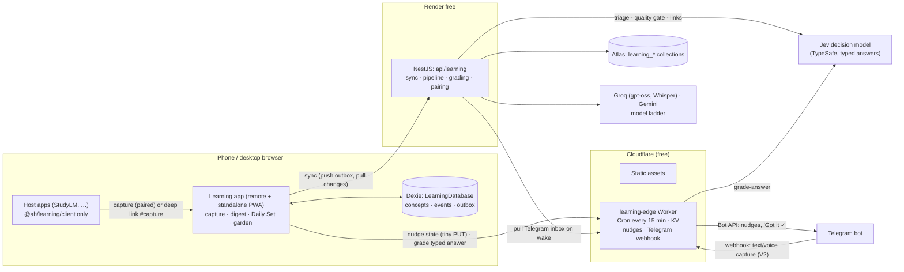

# Learning Engine: technical design

- **Status:** Accepted for decisions 1–3 in §15, recorded in [ADR-0024](../adr/0024-learning-engine.md). Decision 4 (the name) is settled; Jev (decision 5) is still open.
- **Date:** 2026-11-11
- **Product design:** the approved blueprint: zero-friction capture, a capped Daily Set, a forgiving habit loop and an engine that host apps plug into.
- **Audience:** one owner (a personal tool), English only.

The Learning Engine turns quick captures (typed or spoken) into Feynman explanations and recall prompts, then serves a short daily review scheduled with spaced repetition. It is a module with its own data and logic. The other apps in the platform reach it through a small client library.

The design follows four rules from the blueprint: **capture in 5 seconds, review in 3 minutes, an end to every session, and no punishment for missed days.** It also follows what the platform already does: local-first apps, valibot contracts, AI that fails honestly, zero-cost hosting and strict module boundaries.

---

## 1. What the platform already gives us

| Finding                                                                                                                                                                                                                | Consequence for the engine                                                                                                                       |
| ---------------------------------------------------------------------------------------------------------------------------------------------------------------------------------------------------------------------- | ------------------------------------------------------------------------------------------------------------------------------------------------ |
| Nx 24 monorepo, Angular 22 zoneless, Native Federation remotes, each deployed to Cloudflare as static assets (ADR-0001/0002/0007).                                                                                     | The engine's UI is one more remote, `product-learning`, that also runs as a standalone installable PWA.                                          |
| Products are local-first: Dexie per app, with `databaseName(mode, app, …)` keeping portfolio demos apart from real data (`@ah/platform/storage`, `@ah/platform/app-mode`).                                             | The client stores everything in Dexie and works offline. The demo in the portfolio never touches real data.                                      |
| `product-*` scopes never import each other. They may use only `shared`, `platform` and `design-system` (`eslint.config.mjs`).                                                                                          | The engine needs its own scope, and a lint rule that lets products import **only its client library**.                                           |
| StudyLM already has typed AI contracts: valibot schemas compiled to the strict structured-output subset, semantic validators, one repair round, golden fixtures, and errors instead of canned content (ADR-0021/0023). | The engine reuses that pattern. The generic schema compiler is extracted from `product-studylm-lessons` into a shared lib.                       |
| StudyLM's design planned FSRS (`ts-fsrs`), streaks with a weekly freeze, and XP, but never built them. Its cards only count `masteryCount` from 0 to 5.                                                                | The engine delivers these once, for every app. StudyLM becomes its first host.                                                                   |
| AI runs in n8n on your PC behind ngrok, on Groq and Gemini free tiers.                                                                                                                                                 | n8n is offline when the PC is off, which is exactly when you capture on the go. The capture pipeline needs a host that is always reachable (§6). |
| NestJS BFF on Render free (sleeps after 15 min, about 1 min to wake, 750 h a month shared with Orbit API), with MongoDB Atlas free (512 MB). Telegram alerts already go out directly from Nest (`TelegramChannel`).    | The server is the sync point and the pipeline host. It is woken on demand and never kept alive. Telegram is a channel you already use.           |
| `prepare-hosting.mjs` sends `Permissions-Policy: … microphone=()`.                                                                                                                                                     | Voice capture needs `microphone=(self)` on the learning app's origin. This is a required change.                                                 |

---

## 2. Architecture overview



**Where each piece of work runs:**

- **Browser:** capture (saved instantly to an outbox), the Daily Set (composed and played offline), streaks and XP (computed from local data), and the garden.
- **Nest:** the AI pipeline, answer grading, sync, and device pairing. It wakes only when you use the app.
- **Edge Worker:** timed nudges, sub-second grading of typed answers through Jev (§6.3), and later the Telegram capture inbox. It is always on and free, and never wakes Render.

---

## 3. Code layout and module boundaries

The libs follow the platform's conventions (§4.2/§4.3 of the architecture doc) under a new **`scope:learning`**:

```
libs/learning/
├── domain/        type:domain   runtime:agnostic   entities, valibot schemas, FSRS wrapper, Daily Set composer,
│                                                   streak/XP/mastery rules. Pure TS, shared by Angular and Nest.
├── contracts/     type:contracts runtime:agnostic  API DTOs, sync protocol, event group (type-only)
├── ai-kit/        type:domain   runtime:agnostic   prompts, per-task strict schemas, semantic checks, golden concepts,
│                                                   generated kit (Vitest file snapshots, like the lessons lib)
├── data-access/   type:data-access runtime:browser Dexie database, outbox, sync client, LearningStore (SignalStore)
├── client/        type:client   runtime:browser    the ONLY lib host apps may import: capture(), stateFor(),
│                                                   <ah-learn-this>, <ah-learning-today>
├── ui/            type:ui                          swipe card, progress dots, flame, completion, garden (SVG)
└── feature-{capture,digest,review,garden,settings}/ type:feature
apps/products/learning/web/                         remote `product-learning` (port 4311) + standalone PWA
apps/learning-edge/                                 Cloudflare Worker (Cron Trigger + KV + Telegram webhook)
libs/api/learning/                                  Nest module: sync, pipeline, grading, pairing
libs/api/ai/                                        Nest model ladder (Groq → Gemini), reused by the planned `assistant`
libs/shared/ai-schema/                              extracted from product-studylm-lessons: valibot → strict JSON Schema
                                                    post-processing + the strictness spec
```

**Boundary rules (added to `eslint.config.mjs`):**

- `scope:product-*` may also depend on `scope:learning` **only when the lib is also `type:client`**. Bloat is capped by lint: a host app can never reach the store, the database or the screens.
- `scope:learning` may depend on `shared`, `platform` and `design-system`, and never on a product.
- `scope:api` may depend on `learning/domain`, `learning/contracts` and `learning/ai-kit`, which are all `runtime:agnostic`. The scheduler and the checks run the **same code** on both sides.

---

## 4. Data

### 4.1 Entities as stored

The entities from the blueprint, shaped for a document store and for sync. Every record has a client-generated ULID `id`, `updatedAt` and a nullable `deletedAt` (tombstone). Server-stored records also carry a server `seq` used as the change cursor.

```ts
Capture        { id; modality: 'text'|'voice'|'share'|'host'|'telegram'; text|null; audioRef|null; transcript|null;
                 source: SourceRef|null; status: 'queued'|'transcribing'|'structuring'|'ready'|'needs_look'|'failed';
                 attempts; error|null; conceptIds[]; capturedAt }
Concept        { id; captureId; title; topicId; type: 'definition'|'process'|'cause_effect'|'fact'|'skill'|'comparison';
                 difficulty: 1..5; status: 'draft'|'active'|'suspended'|'archived'; confirmedAt|null;
                 explanation: Explanation;            // current version, embedded
                 explanationHistory: Explanation[];   // last 3
                 prompts: RecallPrompt[];             // embedded, 3–6
                 sources: SourceRef[]; version }      // version guards AI rewrites against user edits
Explanation    { version; essence; simple; analogy; misconception; ownWords|null; by: 'ai'|'user'; specVersion }
RecallPrompt   { id; type: 'free_recall'|'cloze'|'why'|'apply'|'contrast'|'spot_error'|'quick_fire';
                 question; answer; options|null; keyPoints[];   // 1–4 short statements a good answer contains (§6.4)
                 relatedConceptId|null; retired; flags[] }
ConceptLink    { id; from; to; relation: 'similar'|'contrasts'|'prerequisite'|'example_of'|'causes'; by; confirmed }
Topic          { id; name; parentId|null; hue; autoCreated }
ReviewEvent    { id; conceptId; promptId; sessionId; at; localDate; rating: 'again'|'hard'|'good'|'easy';
                 answer|null; aiVerdict|null; ms; deviceId }          // append-only
ReviewSession  { id; localDate; kind: 'daily'|'bonus'|'warmup'; planned[]; startedAt; completedAt|null }
TeachBack      { id; conceptId; transcript; clarity: 1..5; gaps[]; at }
LedgerEntry    { id; at; kind: 'freeze_earned'|'freeze_used'|'repair'|'unlock'|'milestone'; ref|null }  // append-only
LearnerProfile { dailyCap: 5|7|10; newPerDay; streakMode: 'daily'|'weekly'; weeklyTarget; desiredRetention: 0.9;
                 timezone; dayStartsAt: '04:00'; nudge: { morning|null; evening|null; learned: boolean };
                 vacationUntil|null }
SourceRef      { app; objectType; objectId; deepLink; excerpt; status: 'live'|'removed' }
Device         { id; name; tokenHash; pairedAt; revokedAt|null }
```

**Derived, never synced as truth:**

- `MemoryState` (stability, difficulty, due date, retrievability, tier) per concept: replayed from `ReviewEvent`s through ts-fsrs.
- `Streak`: from `ReviewEvent.localDate` plus the ledger.
- XP and level: from events through a versioned rules table.
- Mastery tier: from FSRS stability (§5.3).

Each device caches them, and they can always be rebuilt. If the rules or the FSRS parameters change, recomputing applies the change everywhere, with no migration.

### 4.2 Storage

- **Browser:** `LearningDatabase` (Dexie), named through `databaseName(mode, 'learning', 'LearningDatabase')`.
  - Tables: `concepts 'id, topicId, status, seq'`, `events 'id, conceptId, at, synced'`, `memory 'conceptId, dueAt'`, `sessions 'id, localDate'`, `captures 'id, status'`, `outbox 'id, kind, createdAt'`, `topics`, `links`, `ledger`, `profile`.
  - Audio waits in the outbox as a `Blob` until it is uploaded.
- **Server:** Atlas collections `learning_captures`, `learning_concepts`, `learning_links`, `learning_topics`, `learning_review_events`, `learning_teachbacks`, `learning_ledger`, `learning_profile` and `learning_devices`, plus a counter document for `seq`.
  - Audio is deleted after transcription.
  - **Size:** about 3 KB per concept and 200 B per event. 10,000 concepts and 100,000 events come to about 50 MB, a tenth of the free tier.

### 4.3 Sync protocol

There is one owner on a few devices, so sync stays simple and free of conflicts by construction:

```
POST /learning/sync
  → { cursor, deviceId, push: { captures[], conceptEdits[], events[], teachbacks[], ledger[], profile|null } }
  ← { cursor', pull: { concepts[], topics[], links[], captures[] (status changes), events[] (other devices), ledger[] } }
POST /learning/captures/:id/audio   (multipart, ≤ 2 min, opus/webm)
```

- **Append-only records** (events, ledger, teach-backs) are idempotent by `id`, so merging them is a set union. When events arrive out of order from another device, only that concept's memory state is replayed again.
- **Concept edits** use last-writer-wins per field group (`explanation`, `prompts`, `status`, `topic`) by `updatedAt`. **A user edit always beats an AI rewrite:** the pipeline writes only when `concept.version` is still the one it read.
- **When it runs:** after each session or capture, when the app opens, and on `online`. It is never polled. The review never waits on sync.

---

## 5. Scheduling: FSRS, the Daily Set and streaks

### 5.1 FSRS

- **Library:** [ts-fsrs](https://github.com/open-spaced-repetition/ts-fsrs) (MIT, FSRS-6, already picked in StudyLM's design). Desired retention is 0.90, and the user can set it between 0.80 and 0.95.
- **Memory per concept.** Every prompt answers for the same concept. That way prompt formats rotate without resetting memory.
- **Swipes map to ratings:**
  - left = `again`
  - up = `hard`
  - right = `good`
  - right, when the AI verdict is "nailed" and the answer was fast, = `easy`, shown as a "⚡ easy" hint you can undo
- **Concepts start the day after you keep them**, as the blueprint says.

### 5.2 Daily Set composer (pure function in `learning/domain`)

`compose(states, profile, history, localDate) → ReviewSession.planned` is deterministic: the same input gives the same set.

1. **Day boundary:** the day starts at 04:00 in the profile's timezone, so a late-night session counts for the day before.
2. **Due pool:** concepts due by the end of the day, ordered by lowest retrievability.
3. **Slots** (cap 7): about 60 % from the due pool, about 25 % interleaved from other topics (including a `contrast` prompt when a linked concept is also due), and new concepts up to `min(newPerDay = 2, ~15 % of cap)`. Free slots are filled from the due pool, then from concepts almost due.
4. **Order:** two cards in a row never share a topic when the pool allows it. The set starts with an easy card (highest retrievability) for momentum.
5. **Prompt choice per concept:** the least-used type that isn't the one used last time. At most 2 `free_recall` per set (to stay inside 3 minutes) and at most 1 teach-back (only for concepts at Leaf or above).
6. **Adaptive load:** if more than 40 % were missed over the last 3 sessions, or a session was abandoned, the cap drops by 2 (minimum 3) and no new concepts come in. The UI says "Lighter set today".
7. **Backlog stays invisible.** Overdue concepts simply stay due, and FSRS handles long gaps. No count of what's owed is ever shown.

The set is frozen when the day's first session starts, so the promise of 7 cards holds even when more become due during the day. Missed cards return once at the end of the session with a different prompt type.

### 5.3 Streaks, XP and mastery (pure rules, computed from events)

- **Days:**
  - **Ember day:** at least 1 review event on the local date.
  - **Full day:** the Daily Set was completed.
  - Both count toward the streak.
- **Freezes:** 1 `freeze_earned` per 7 consecutive days, at most 2 banked. A one-day gap uses one automatically (`freeze_used`).
- **Repair:** once every 30 days, completing two sets the day after a break writes `repair`.
- **Weekly mode:** the streak counts weeks with at least `weeklyTarget` active days.
- **Mastery tier from FSRS stability:**
  - Seed (never reviewed)
  - Sprout (< 3 d)
  - Leaf (3–21 d)
  - Bloom (21–90 d)
  - Golden (≥ 90 d)
  - **Wilting:** retrievability now < 0.80.
- **XP:** a versioned table. Teach-back and correct `hard` answers weigh most, and nothing pays for reading.

---

## 6. AI pipeline

### 6.1 Where it runs: Nest, not n8n (decision 1)

Captures happen on the go, when the PC that runs n8n may be off. Nest on Render wakes on the capture request itself, and the architecture already plans a Gemini → Groq ladder in Nest for the `assistant` module. The ladder is built once in `libs/api/ai` and serves both.

n8n stays available for extras that are allowed to be late (a weekly email recap, for instance). It is never on the capture path.

### 6.2 Stages

```
capture accepted (202) ─► transcribe ─► triage ─► extract-concepts ─► explain-concept ×N ─► checks + quality gate ─► repair ≤1 ─► link-suggest ─► draft (digest)
```

Two kinds of model do the work. A **generative ladder** writes text. A **decision model** (Jev, §6.4) answers typed questions about text that already exists. Every decision task has a ladder fallback, so Jev is never a single point of failure.

| Task                 | Input                                                                | Output                                                                                                       | Model                                        |
| -------------------- | -------------------------------------------------------------------- | ------------------------------------------------------------------------------------------------------------ | -------------------------------------------- |
| transcribe           | audio ≤ 2 min                                                        | text                                                                                                         | Groq `whisper-large-v3-turbo` → Gemini audio |
| `triage`             | capture text                                                         | `choice`: learnable idea / to-do or reminder / noise. Non-learnable captures ask before processing.          | **Jev** → ladder                             |
| `extract-concepts`   | capture text, source excerpt, existing topic names                   | 1–3 concepts: title, type, topic (existing or new), span                                                     | ladder                                       |
| `explain-concept`    | concept, span, type, learner level                                   | Explanation + 3–6 prompts with `keyPoints` (type mix fixed by concept type)                                  | ladder                                       |
| `quality-gate`       | the concept's explanation and prompts, the source span               | `noul` per check: faithful to the source, misconception really wrong, question leaks no answer, plain enough | **Jev** → ladder                             |
| `repair`             | the object + issues (`path`, `message`)                              | corrected object                                                                                             | ladder                                       |
| `link-suggest`       | concept + up to 20 candidates (lexical prefilter on titles/essences) | one `choice` per candidate: a relation or `none`, with probabilities; duplicate check by `noul`              | **Jev** → ladder                             |
| `grade-answer`       | prompt, key points, learner's answer                                 | `noul` per key point ("does the answer state …?") → verdict, missed points, suggested rating                 | **Jev** → ladder, 6 s budget                 |
| `teachback-feedback` | concept, key points, transcript                                      | `noul` per key point + `score` for clarity (coarse, 3 bands)                                                 | **Jev** → ladder                             |
| `revise-explanation` | explanation, instruction ("simpler", "focus on the formula")         | new Explanation version                                                                                      | ladder                                       |

- **Schemas:** each task has its own small valibot schema in `learning/ai-kit`, compiled to the strict subset by `@ah/shared/ai-schema`. Everything carries a `specVersion` and is snapshot-tested, exactly as the lessons kit is.
- **Prompts live on the server.** The client sends `{ task, input }` only, so the API can't be used as a free model proxy. User text is fenced as data.
- **Semantic checks**, each returning `{ path, code, message }` for the repair call:
  - The essence is ≤ 20 words and the simple explanation ≤ 80.
  - A cloze has exactly one blank, and its answer appeared in the original sentence.
  - A multiple-choice answer is among 3–4 unique options.
  - No question contains its own answer.
  - `contrast` needs a real related concept.
  - `spot_error` must differ from its correction.
  - `quick_fire` is never the only prompt.
  - A model-declared `uncertain: true` sends the concept to **Needs a quick look**.
- **Honest failure, as in StudyLM.** When the ladder is exhausted, the capture is marked `failed` and retried with backoff (1 min, 10 min, next wake). After 3 tries it shows a Retry button. Nothing is ever filled in, and the raw capture is never lost.
- **Durability without a queue service:** the capture document is the job. The Nest process runs it right after accepting it. A sweep at boot and every 5 min while awake picks up `queued` or `structuring` jobs older than 2 min. Captures sent while Render sleeps are processed on its next wake.
- **Golden concepts:** about 12 hand-written concepts covering every concept type, each with its explanation and prompts, passing every check. They serve as the validators' ground truth, the prompts' examples, the demo content and the e2e fixtures.

### 6.3 Grading never blocks the review

- **Typed answers are graded at the edge.** The `learning-edge` Worker is always on, so grading never waits for Render to wake. It checks the device token and sends the answer to Jev, getting one `noul` per key point. Expected time end to end is under 1 s.
- **Voice answers** are transcribed first, which goes through Nest. When the review screen opens it pre-warms `/health`, the platform's existing pre-warm-on-intent pattern.
- **From key points to a verdict, in code:**
  - every key point has p ≥ 0.7 → **nailed**
  - at least one has p ≥ 0.7 → **close, you missed X** (X is the key point text itself, so nothing is generated)
  - none does → **missed**
  - any key point in the uncertain band (0.35–0.7) → no verdict is shown
- **Budget:** 6 s. A late or failed verdict is dropped silently, and the swipe self-grade works as usual.
- **The swipe is always the rating.** The AI only suggests. Each swipe that disagrees with the suggestion is logged as a labelled example (§6.4).

### 6.4 Jev: a decision model for the judging tasks (proposed, decision 5)

[Jev](https://docs.typesafe.ai) by TypeSafe AI came out in early access on 2026-09-15. It is a "System One" model: you send a `state` (text or JSON) and typed questions, and every question is answered in parallel with a typed value. It never writes prose.

| Type     | Returns                                                    | Used for                                                            |
| -------- | ---------------------------------------------------------- | ------------------------------------------------------------------- |
| `noul`   | probability that a statement is true (0–1)                 | key point covered, faithful to the source, answer leaked, duplicate |
| `choice` | one option of 1–255, with `confidence` and `probabilities` | triage, link relation, topic among existing topics                  |
| `score`  | a level on an ordered scale of 2–10, with `probabilities`  | clarity of a teach-back, in coarse bands only                       |

**Why it fits:** half of the engine's AI tasks are judgments, not writing.

- **Speed:** the vendor reports 70–500 ms, against several seconds for a ladder call. That is what makes grading during a swipe feasible.
- **Probabilities:** answers come with probabilities, which give the thresholds for "no verdict" and "needs a quick look".
- **Structured by design:** typed answers mean no parsing, no repair round and no malformed JSON.
- **Cheaper:** about $0.04 per million input tokens through Vercel's AI Gateway.
- **Better feedback:** **key points** turn grading into a list of yes/no questions. "You missed X" quotes the concept's own key point, so feedback can't be made up.

**What the evidence says, and how the design copes:**

- **Results are mixed.** Accuracy varies widely between reviewers: one third-party benchmark ranked it last of twelve systems on LegalBench, while others scored it well on classification sets. Rubric agreement is modest (κ ≈ 0.30–0.47), one tester measured a 16 % false-accept rate when it served as a gate, and its `score` levels are weakly calibrated numerically.
  - → Jev only ever **suggests** (grading) or **adds** a check (quality gate). The deterministic checks in code stay. Scores are used in coarse bands only, never as a number.
- **No counting, arithmetic or date comparison.** → Word limits, blank counts and option checks stay in code (§6.2).
- **Unrelated context lowers accuracy.** → Each request carries only the prompt, the key points and the answer, never the whole concept.
- **Early access only:** no free tier is published, and there are no self-hosted weights.
  - → Jev sits behind a `DecisionModel` port in `libs/api/ai`. Its fallback adapter asks the generative ladder the same typed questions through a strict JSON schema, without calibrated probabilities, so the uncertain band shows no verdict.
  - Turning Jev off is one config change.
  - Calls go through Vercel's AI Gateway or TypeSafe's API, with the key held in Render and Worker secrets.
- **Privacy:** answers and capture text go to one more processor. For a personal tool this is acceptable. The rule that audio is never sent stays.

**How it is adopted: a spike in L2, then a go/no-go decision.**

1. Label a set by hand: about 150 answers to golden-concept prompts (right, partly right, wrong, off-topic, and paraphrases of right answers), plus about 40 deliberately broken explanations for the quality gate.
2. Measure per question type: agreement with the labels, false accepts at the chosen thresholds, latency from the Worker, and cost. Compare with the ladder on the same set.
3. **Go when** grading agrees with the labels at least 85 % of the time with ≤ 10 % false "nailed", and median latency is under 1 s. Otherwise grading stays on the ladder and Jev keeps only the tasks it passed.
4. **Ongoing:** every swipe that disagrees with Jev's suggestion is stored as a label. A monthly check re-measures agreement, so drift shows up in your own data.

---

## 7. Capture surfaces

| Surface                           | Mechanism                                                                                                                                                                                                                                                                                                    | Phase |
| --------------------------------- | ------------------------------------------------------------------------------------------------------------------------------------------------------------------------------------------------------------------------------------------------------------------------------------------------------------ | ----- |
| Quick capture in the learning app | A floating ✦ button. A tap opens an autofocused text sheet with a draft saved on every keystroke. Holding it records voice (`MediaRecorder`, opus) and saves on release. The capture is written to Dexie and the outbox first, then shows "Got it ✓" and a 10 ms vibration (`navigator.vibrate` on Android). | L2    |
| PWA shortcuts                     | Manifest `shortcuts`: long-press the home-screen icon for **Capture** or **Today's set**.                                                                                                                                                                                                                    | L2    |
| Share sheet (Android)             | Manifest `share_target` with **GET** (title, text, url) → `/capture#…`. GET needs no custom service worker code. Files (screenshots) need a POST target and an `importScripts` shim around ngsw, so they come later.                                                                                         | L4    |
| Host apps                         | `<ah-learn-this [source]>` and `capture()` from `@ah/learning/client` (§9).                                                                                                                                                                                                                                  | L4    |
| Telegram                          | Send or forward text or a voice note to your bot. The edge Worker stores the update (voice as its Telegram `file_id`, never the audio) and replies "Got it ✓". Nest pulls the inbox on wake, the ADR-0010 backstop pattern.                                                                                  | L5    |

**Required platform change:** voice capture needs `microphone=(self)` on the learning app's origin in `prepare-hosting.mjs`. Other apps stay at `()`.

---

## 8. Review UI (mobile first)

- **Screens:** `/today` (opens straight on card 1), `/digest`, `/capture`, `/garden`, `/settings` and `/pair`. Each has its own URL and lazy chunk, like Basecamp and StudyLM.
- **Swipe:** Pointer Events with a distance-or-velocity threshold. The card follows the finger with CSS transforms and flies off with the Web Animations API. Rotation is limited to 8°.
- **Swipes are never the only input.** Buttons sit under the card, and on desktop `←` `↑` `→` grade and `Space` reveals.
- **Reduced motion:** a reactive `prefers-reduced-motion` signal (as in the StudyLM player) swaps the fly-off animation for an instant change.
- **Celebration:** confetti (`canvas-confetti`, already a dependency) is lazy-loaded at completion and skipped under reduced motion.
- **Offline first:** the set, the prompts and the explanations are all local. Only grading and sync need the network.
- **Accessibility:** progress dots form a labelled progressbar, the reveal moves focus to the answer, and axe runs in e2e and Storybook. The colour rules of the design system apply, including the `--color-data-*` restriction to stage panels.
- **Garden (L5):** deterministic SVG, laid out from topic and concept ids, with no Three.js so it stays light on phones. Tiers and wilting come from the derived memory state.

---

## 9. Integration with host apps

**The client library (`@ah/learning/client`, about 5 KB, no Dexie) is the whole contract:**

| Verb      | API                                                     | Behaviour                                                                                                                                                                                                                                                                                                                             |
| --------- | ------------------------------------------------------- | ------------------------------------------------------------------------------------------------------------------------------------------------------------------------------------------------------------------------------------------------------------------------------------------------------------------------------------- |
| Capture   | `capture({ text, source })`, `<ah-learn-this [source]>` | **Paired origin** (the shell, or the learning app's own): `POST` to Nest, with a tiny per-origin outbox when offline. **Unpaired origin** (for example standalone StudyLM): opens `https://<learning-app>/capture#text=…&src=…`. The fragment never reaches a server, and the paired learning app saves it. Zero setup on any origin. |
| Query     | `stateFor(sourceRef)` → `{ tier, due } \| null`         | Paired origins only, otherwise `null`, so hosts hide their badges.                                                                                                                                                                                                                                                                    |
| Embed     | `<ah-learning-today>`                                   | A chip showing today's count and the flame, linking to `/today`. **The review itself never embeds in another app.** That keeps hosts small, and the habit lives in one place.                                                                                                                                                         |
| Subscribe | `learningEvents` group in `@ah/shared/contracts`        | `conceptCaptured`, `dailySetCompleted`, `conceptMastered`, `streakExtended`, through the SignalStore Events plugin, so remotes in the shell react with no imports (architecture §5.4).                                                                                                                                                |

**StudyLM, the first host:**

- At the end of a lesson, its `CardSeed`s become "Add to my reviews". That sends a `host` capture with the seeds as structured input, which skips `extract-concepts`.
- Each flashcard gets `<ah-learn-this>`.
- **Decision 3:** the engine replaces StudyLM's planned FSRS (Practice and review phase) and streaks/XP (Focus and Today phase). StudyLM's `learning-lab.md` roadmap would point to the engine, and `masteryCount` stays only for StudyLM's own drill mode.

**Portfolio demo:**

- In `embedded-demo` mode the app opens `ah-demo-learning`, seeded with the golden concepts and 30 days of synthetic events, so the streak and the garden look alive.
- Capture plays recorded fixture replies.
- The demo never syncs, never pairs and never calls AI. It is labelled as a demo.

---

## 10. Nudges: the edge Worker (decision 2)

Render must not be woken on a timer: its 750 h a month are shared with the Orbit API. So nudges live on Cloudflare:

- **`apps/learning-edge`:** a Worker with a Cron Trigger every 15 min and one KV namespace, deployed with wrangler like the remotes.
- **Nudge state in KV:** timezone, morning and evening times, last active date, the date of the last completed set, the streak, today's count, a snooze and a send log.
  - The learning app writes it with a small authenticated `PUT` after each session and each settings change. That is a handful of writes a day, far below the free plan's limit of 1,000.
- **Each cron run** is a pure decision function: "is it nudge time in the user's timezone, is today's set still open, is the daily budget (≤ 2) left?"
  - If yes, it sends a Telegram message through the Bot API, with a button linking to `/today`. Example: "☕ Your 3-min set is ready. Keep the 🔥 12 alive."
- **Learned time:** the app computes the median start time of the last 14 sessions, minus 10 min, and writes it as the morning time.
- **No nudges** in vacation mode, and none once the set is done.
- **Why Telegram and not Web Push:**
  - Push needs a server-held subscription plus VAPID signing from the Worker.
  - Delivery to an installed PWA on Android is less reliable than Telegram.
  - You already use the bot for alerts.
  - Web Push can be added later behind the same decision function.

---

## 11. Security

- **One owner, paired devices.** In the learning app, `/pair` shows a 6-digit code. You send `/pair 123456` to your bot, which answers only your `TELEGRAM_CHAT_ID`. The device then receives a token.
- **Tokens** are stateless and HMAC-signed (`deviceId.expiry.sig`, 180 days, the same idea as Dispatch's session tokens). A secret shared by Nest and the Worker validates them with no database lookup.
  - Revocation goes in a KV list and in `learning_devices`. `/devices` in the bot lists devices and revokes them.
- **API protections:**
  - Every `/learning/*` route requires the token, with throttling (`@nestjs/throttler`).
  - Task inputs are capped (16,000 characters, 2 min of audio).
  - CORS is limited to the shell's and the learning app's origins.
- **Content Security Policy:** `connect-src` gains the API and Worker origins, and `microphone=(self)` is added for the learning app.
- **Privacy:** audio is deleted after transcription, and capture text never goes into a URL query (fragments only). The demo is fully local.

---

## 12. Free-tier budget (personal use)

| Resource                 | Expected use                                                             | Limit that matters                                                                                                                                   |
| ------------------------ | ------------------------------------------------------------------------ | ---------------------------------------------------------------------------------------------------------------------------------------------------- |
| Model tokens per capture | extract ~1.5 K + explain ~2.5 K per concept + links ~1 K ≈ **5–8 K**     | Groq: about 8 K tokens a minute per model. Two concepts a minute, with the ladder and pacing absorbing bursts of 20 captures a day.                  |
| Grading                  | ≤ 2 free-recall answers per set, ~1 K each                               | negligible                                                                                                                                           |
| Jev decisions            | grading, triage, quality gate and links ≈ **150 K input tokens a month** | No free tier is published. At about $0.04 per million input tokens (Vercel AI Gateway), that is under $0.01 a month, but it needs a billing account. |
| Transcription            | ≤ 20 voice notes a day, ≤ 2 min each                                     | Groq's free audio limits (**to check before L2**)                                                                                                    |
| Render                   | 2–4 wakes a day × ~15 min ≈ **30 h/month**                               | 750 h shared with Orbit API                                                                                                                          |
| Atlas                    | ~50 MB after years of use                                                | 512 MB                                                                                                                                               |
| Worker and KV            | 96 cron runs a day, < 50 KV writes a day                                 | 100 K requests a day, 1 K writes a day                                                                                                               |

If free-model quality proves too weak for explanations, the ladder can take a paid rung (for example Claude Haiku 5.5) for `explain-concept` only. The strict schemas already fit Claude's structured outputs.

---

## 13. Testing

- **`learning/domain` (Vitest):**
  - Composer invariants as property tests: the cap holds, at most 2 new concepts, no adjacent same-topic cards when avoidable, and a deterministic result for the same input.
  - Streak edge cases: daylight-saving changes, changing timezones, the 04:00 boundary, freezes, repair and weekly mode.
  - FSRS replay is independent of the order events arrive in.
- **`learning/ai-kit`:**
  - Strictness spec for every schema, reusing the lessons rule check.
  - The golden concepts pass every check with zero warnings.
  - Broken fixtures assert the issue path and code.
  - Generated-kit snapshot drift fails CI.
- **`api/learning`:**
  - In-memory repositories, following `libs/api/leads/src/lib/testing`.
  - The pipeline against a fake ladder: good reply, unparsable reply, schema break, repair, exhausted ladder with backoff.
  - Sync idempotency and the edit-beats-AI version guard.
  - Token issue, expiry and revocation.
- **`learning-edge`:** the cron decision function is pure and tested across timezones. Telegram and Jev are tested through a fake `fetch`.
- **Decision model:**
  - The key-points-to-verdict mapping and its thresholds are pure functions, tested at the band edges.
  - Both `DecisionModel` adapters (Jev and the ladder fallback) run the same contract tests against recorded replies.
  - The labelled set from the L2 spike is kept as a regression benchmark. Re-run it after any Jev version bump (the reply's `model` field names the build).
- **e2e (Playwright in `shell-e2e`, API stubbed):** capture text → keep it in the digest → advance a day with `page.clock` → seven swipes on a touch-emulated mobile viewport → completion → streak 1. Axe runs on every screen.
- **Storybook:** swipe card, progress dots, flame, completion and garden, with axe on each story.

---

## 14. Delivery phases

Each phase ships on its own and leaves `main` green.

| Phase               | Scope                                                                                                                                                                                                                                               | Done when                                                                     |
| ------------------- | --------------------------------------------------------------------------------------------------------------------------------------------------------------------------------------------------------------------------------------------------- | ----------------------------------------------------------------------------- |
| **L0 Decisions**    | ADR-0024. Extract `@ah/shared/ai-schema` from `product-studylm-lessons` (no behaviour change; its 116 tests stay green). Add the lint boundary rules.                                                                                               | ADR merged, lessons tests unchanged                                           |
| **L1 Backbone**     | `learning/domain` and `learning/contracts`, Nest `api/learning` (pairing, sync, concepts), Dexie data access with the outbox, an empty remote with `/pair`. Manual text concepts only.                                                              | Two devices pair and stay in sync offline and online                          |
| **L2 Capture**      | `ai-kit`, golden concepts, `libs/api/ai` ladder, text and voice capture, pipeline, digest with swipe-to-keep and "simpler please", PWA shortcuts, `microphone=(self)`. **Jev spike** (§6.4): `DecisionModel` port, labelled set, go/no-go per task. | A 15 s voice note becomes kept concepts with no typing; Jev go/no-go recorded |
| **L3 Daily Set** ⭐ | Composer, review screen, grading, completion screen, streaks and freezes, XP, `learning-edge` nudges on Telegram.                                                                                                                                   | **You use it daily.** This is the first adherence milestone.                  |
| **L4 Integration**  | `@ah/learning/client`, StudyLM hooks, `<ah-learning-today>`, the events group, the share target, the portfolio demo with seeded data.                                                                                                               | "Learn this" in StudyLM lands in tomorrow's set                               |
| **L5 Delight**      | Garden, teach-back, contrast and interleaving prompts, weekly recap on Telegram, Telegram capture, repair window, cosmetics.                                                                                                                        | Set by the blueprint's success metrics                                        |

---

## 15. Decisions

Accepted on 2026-11-11:

1. **The AI pipeline runs in Nest on Render**, which wakes on demand. n8n stays off the capture path because it is unavailable while you are away from the PC.
2. **Nudges go out through a Telegram bot from a Cloudflare edge Worker.** Web Push can be added later behind the same decision function.
3. **The engine replaces StudyLM's planned FSRS and streak phases.** StudyLM's `learning-lab.md` roadmap is updated to point here when L4 lands.
4. **Name:** the remote is `product-learning`, the Worker `learning-edge` and the database `LearningDatabase` (accepted the same day).

Still open:

5. **Jev for the judging tasks (proposed):** grading, triage, the quality gate, links and teach-back clarity go to Jev behind a `DecisionModel` port, with the generative ladder as fallback. It is adopted per task only if it passes the L2 spike (§6.4). It needs a paid account at under $0.01 a month, which is the engine's only non-free dependency.

## Sources on Jev (checked 2026-11-11)

- [TypeSafe docs: introduction](https://docs.typesafe.ai) and [quick start](https://docs.typesafe.ai/introduction/quickstart.md): question types, `POST /v1/systemone`, the response shape.
- [AI/ML API reference for Jev 1.13](https://docs.aimlapi.com/api-references/decision-models/typesafe/jev-1.13): request and response fields, a 262 K context window.
- [Vercel AI Gateway: `typesafe-ai/jev`](https://vercel.com/ai-gateway/models/jev.md): price per input token, `decide()` in the AI SDK.
- [Let's Data Science: launch report](https://letsdatascience.com/news/typesafe-ai-launches-jev-decision-model-889a38c0): vendor latency of 70–500 ms, early access.
- [Vals AI: independent evaluation](https://vals.ai/blogs/independent-evaluation-of-jev) and [Towards AI: "A decision model as a gate"](https://pub.towardsai.net/a-decision-model-as-a-gate-fast-well-calibrated-and-still-wrong-16-of-the-time-2ddb226b1ed5): mixed accuracy, a 16 % false-accept rate, modest rubric agreement.
- [OrcaRouter: Jev limitations](https://www.orcarouter.ai/blog/jev-limitations): no arithmetic, counting or date comparison, and accuracy drops with unrelated context.
