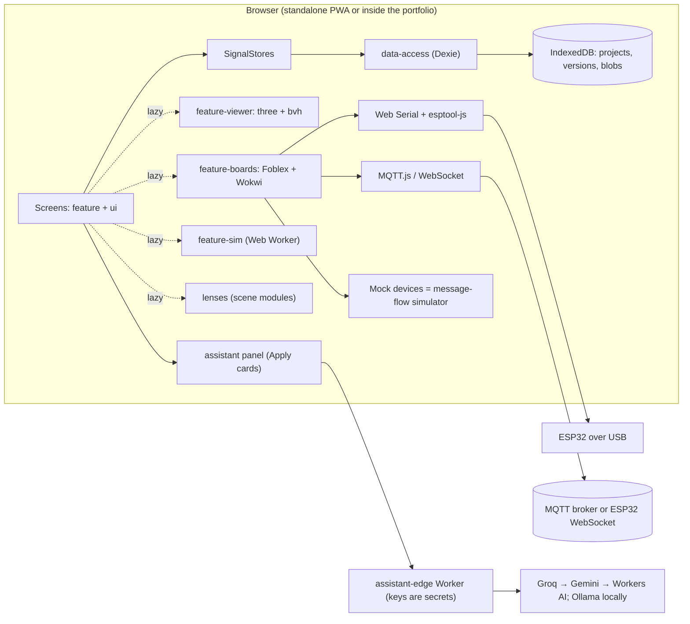

# Project Workbench: Phase 0 plan

> **Status: Proposed, waiting for the owner's approval.** Nothing in this plan is built yet. When it is approved, the decisions go into ADR-0032 and the slices start in order (§7).
> Written 2026-11-26 on `docs/project-workbench-plan`, from `origin/main` at `f91cf0f`. Library facts were checked online the same day (§11).

## 0. In one paragraph

The Workbench is where the owner keeps project ideas and grows each one into a full build plan. An idea is captured in seconds (text, link, photo, voice note). It becomes a dossier with sources and labelled assumptions, a task board and a budget. Then the project can be simulated, viewed in 3D, wired on a canvas of ESP32 boards (live over USB or MQTT, or mocked), and learned, with a curriculum generated from what the project needs. It works offline and keeps data on the device. The first project it must carry end to end is a **DIY laser tag system**: ESP32 blasters and vests, an IR protocol, game modes, a player app, and a cost and funding model.

**Assumptions the owner gave, kept as stated:**

- "Cards" means ESP32 and similar boards, each drawn as a card on the canvas.
- "3D interactive lenses" means interactive explainers. Each one has a plain 2D fallback and a text alternative.

## 1. Rules from this repo I must follow

From `AGENTS.md`, `docs/architecture.md`, ADR-0001 to ADR-0031 and the System Design hard rules (§0 of its technical design), the template every new product follows:

| Area          | Rule                                                                                                                                                                                                                                                                                                                                                                                                                     |
| ------------- | ------------------------------------------------------------------------------------------------------------------------------------------------------------------------------------------------------------------------------------------------------------------------------------------------------------------------------------------------------------------------------------------------------------------------ |
| Stack         | Nx 24 integrated monorepo, pnpm 10, one root `package.json` (single version policy). Angular 22: zoneless, standalone OnPush components, signal `input()`/`output()`/`model()`, `inject()`, `@if`/`@for`, Signal Forms. TypeScript 6 strict. NgRx SignalStore for feature state. No `zone.js` anywhere (ESLint and `check:zoneless`).                                                                                    |
| Products      | A product is a Native Federation remote under `apps/products/<name>/web`. It runs inside the portfolio (`/apps/<name>`) and on its own as a PWA on Cloudflare. Libs live in `libs/products/<name>/*`. A new remote gets a port (next free: **4315**) and an entry in `tools/federation/remotes.json`.                                                                                                                    |
| Boundaries    | Tags `scope:` / `type:` / `runtime:`, enforced by `@nx/enforce-module-boundaries`. `scope:product-workbench` may import only itself plus `shared`, `platform`, `design-system` and `learning-client`. Never another product. `domain` is pure TypeScript (`runtime:agnostic`, no Angular). `ui` never imports `data-access`. Nx forbids importing one lib both statically and lazily, so every lazy area is its own lib. |
| Design system | Tokens (DTCG JSON → Style Dictionary) with a WCAG contrast gate (4.5:1 text, 3:1 graphics). `.scss` files only, semantic tokens only, no hex, logical properties only, no `transition: all`: stylelint-STRICT from day one. SVG colours come from classes, not `fill=` attributes. New `@ah/ui` components need a story, a spec, axe and a Docker screenshot baseline, and exist only when a page needs them.            |
| Rendering     | No `innerHTML` (rich text is built with templates or Renderer2, as SerraCalc's MathML is). No `@angular/animations` (CSS or WAAPI). Respect `prefers-reduced-motion`.                                                                                                                                                                                                                                                    |
| Languages     | `PreferencesStore.language` is the one source of truth (`en`, `fr`, `ar`, `it`, `de`; ADR-0018). Each app owns typed copy files; a missing key fails the build. No runtime i18n library. Arabic keeps Latin digits (`ar-u-nu-latn`). Drawings keep their geometry left to right and isolate translated words.                                                                                                            |
| 3D            | `@ah/three/engine` (framework-free stage, frame loop that draws only on demand, quality tiers, strict `dispose()`) and `<ah-scene>` (fallback first, scene module loaded when idle). `three` is a shared federation singleton, never in an initial bundle.                                                                                                                                                               |
| Storage       | Dexie on IndexedDB, database names from `@ah/platform/storage` (`databaseName`), so the portfolio demo never opens real data. The feature passes the name to `data-access`, which may not import `@ah/platform/*`.                                                                                                                                                                                                       |
| AI            | ADR-0031: "the model proposes, the app acts". Keys live only in Worker secrets (`apps/assistant-edge`). The browser sends the app id, the conversation and its state, never prompts or tool definitions. Writes run only after the reader presses **Apply** on a card worded by the app.                                                                                                                                 |
| Security      | Strict CSP generated by `tools/scripts/prepare-hosting.mjs` (`connect-src` lists origins). `Permissions-Policy` sets `microphone=()` unless a flag allows it. No secrets in the repo, logs or prints.                                                                                                                                                                                                                    |
| Tests and CI  | Vitest specs beside the code, Playwright e2e in `apps/portfolio/shell-e2e` with axe (light, dark, Arabic). Storybook with axe and visual regression. `main` is protected: "Lint, test, build, e2e" and "Storybook". `pnpm nx format:write`, then lint, test and build the touched projects before a slice is done.                                                                                                       |
| Git           | Branch per slice, conventional commits, merge commits (not squash). One agent per checkout. At every stop: commit, update `docs/<area>/AI_HANDOFF.md` (§0, §2, §6), push.                                                                                                                                                                                                                                                |
| Owner's taste | Controls that suit the data, not sliders everywhere; reusable pieces go into `@ah/ui`. Every change checked at phone, tablet and desktop widths, right to left, dark and sunlight modes, with real touch where gestures matter. Free tiers only.                                                                                                                                                                         |

**Already in the repo and reused here:** Dexie 4.4.7, three 0.186.1, ts-fsrs 5.4.2, Valibot 1.5, `@ah/three/*`, `@ah/platform/{storage,assistant,tour}`, `@ah/shared/assistant(-engine)`, `@ah/learning/client` ("Learn this" hand-off to the Learning Engine), `@ah/ui` controls (`ah-dial`, `ah-stepper`, `ah-ruler`, `ah-thermometer`, `ah-segmented-control`, `ah-tabs`, `ah-modal`, `ah-file-dropzone`, `ah-flow-chart`, `ah-action-card`, `ah-coachmark`…) and SerraCalc's patterns (backups, service worker prefetch, blocked-database notices, draggable SVG handles with arrow keys).

**Not in the repo, despite `architecture.md`:** the custom Nx generators (§4.4). New projects are copied by hand from SerraCalc and the Learning Engine.

## 2. Two findings that shape the plan

1. **Inside the portfolio, a remote runs in the shell's page, so the shell's `Permissions-Policy` applies.** It turns the microphone off and doesn't allow serial or Bluetooth. Voice notes, Web Serial and Web Bluetooth therefore work in the **standalone app only**. Inside the portfolio the Workbench shows the mock devices and says why.
2. **The CSP must list every origin the page connects to.** A broker address typed by the user is blocked unless its origin is in `connect-src`. The standalone app's CSP will list `ws://localhost:*`, `ws://127.0.0.1:*` and the broker(s) the owner chooses (open question 6). The portfolio demo uses mock devices only.

## 3. Open-source research (checked 2026-11-26)

Columns: licence; latest release; size (minified + gzip of the whole package from Bundlephobia; tree-shaking usually ships less); accessibility; fit with this repo. Release dates come from the npm registry and repo activity from the GitHub API, both read the same day.

### 3.1 3D viewer

| Candidate                                                                                          | Licence    | Latest release      | Size (gzip)                                      | Accessibility                                                     | Fit                                                                                                                                | Verdict    |
| -------------------------------------------------------------------------------------------------- | ---------- | ------------------- | ------------------------------------------------ | ----------------------------------------------------------------- | ---------------------------------------------------------------------------------------------------------------------------------- | ---------- |
| **three.js** (repo pins 0.186.1) + its addons (GLTFLoader, STLLoader, OrbitControls, GLTFExporter) | MIT        | 0.187.0, 2026-10-30 | about 189 kB, already paid and shared (ADR-0011) | Nothing built in; we add keyboard camera, DOM hotspots, part tree | Already the platform's engine, with `@ah/three/engine` and `<ah-scene>`. STL and glTF loaders are in the same package              | **Chosen** |
| **three-mesh-bvh**                                                                                 | MIT        | 0.10.0, 2026-11-24  | 28 kB                                            | n/a                                                               | Fast raycasting for measuring and picking on big meshes; mesh-to-mesh intersection for the fit check (§3.4)                        | **Chosen** |
| Google `<model-viewer>`                                                                            | Apache-2.0 | 4.4.0, 2026-10-09   | 72 kB plus its own three                         | Good: keyboard orbit, hotspot buttons, `alt`                      | Peer `three@^0.183` clashes with the repo's 0.186 (single version). glTF only (no STL). No section cut, exploded view or measuring | Rejected   |
| Babylon.js                                                                                         | Apache-2.0 | 9.38.0, 2026-11-26  | about 1.8 MB for `@babylonjs/core`               | Not checked                                                       | A second 3D engine beside three, much heavier                                                                                      | Rejected   |
| angular-three                                                                                      | MIT        | 4.2.4, 2026-07-15   | n/a                                              | n/a                                                               | Peers `@angular/core <22` and `three <0.183`: it can't be installed here                                                           | Rejected   |

### 3.2 Interactive canvas and node editor

| Candidate                        | Licence                                                             | Latest release      | Size (gzip)          | Accessibility                                                                                                                                                | Fit                                                                                                                                                                                         | Verdict                       |
| -------------------------------- | ------------------------------------------------------------------- | ------------------- | -------------------- | ------------------------------------------------------------------------------------------------------------------------------------------------------------ | ------------------------------------------------------------------------------------------------------------------------------------------------------------------------------------------- | ----------------------------- |
| **Foblex Flow** (`@foblex/flow`) | MIT                                                                 | 19.4.0, 2026-10-25  | 114 kB whole package | ARIA semantics by default; opt-in keyboard layer: spatial navigation, move, delete and connect without a mouse, screen-reader announcements, remappable keys | Angular-native, "zoneless-ready", SSR-safe. Classic mode renders arrays or signals the app owns and emits `fCreateConnection`, `fMoveNodes`: our domain validates each wire before it lands | **Chosen**, behind an adapter |
| ngx-vflow                        | MIT                                                                 | 2.7.0, 2026-09-03   | 32 kB, plus d3 peers | Keyboard shortcuts; no documented ARIA or screen-reader support                                                                                              | Angular, signals since v2; lighter, but the accessibility layer would be ours to build                                                                                                      | Fallback                      |
| React Flow (`@xyflow/react` 13)  | MIT                                                                 | 13.0.3, 2026-11-23  | n/a                  | Good (documented)                                                                                                                                            | React: a second framework in an Angular product                                                                                                                                             | Rejected                      |
| tldraw 5.6                       | tldraw licence (not permissive: production use needs a licence key) | 5.6.2, 2026-11-20   | n/a                  | n/a                                                                                                                                                          | React, licence                                                                                                                                                                              | Rejected                      |
| Excalidraw                       | MIT                                                                 | 0.18.1, 2026-04-20  | n/a                  | n/a                                                                                                                                                          | React; a whiteboard, not a node graph                                                                                                                                                       | Rejected                      |
| Konva                            | MIT                                                                 | 10.11.0, 2026-11-23 | 56 kB                | Canvas pixels: nothing for assistive tech                                                                                                                    | Low-level drawing; we'd rebuild nodes, ports and accessibility                                                                                                                              | Rejected                      |
| Rete.js (`rete-angular-plugin`)  | MIT                                                                 | 2.7.1, 2026-07-10   | n/a                  | n/a                                                                                                                                                          | Peers `zone.js`, which ESLint bans (zoneless)                                                                                                                                               | Rejected                      |

Foblex Flow is a small team's project (541 stars, 7 open issues). The circuit model lives in our domain and Foblex is only the view, so ngx-vflow or our own SVG canvas (we already have draggable SVG handles with arrow keys) could replace it without touching data.

### 3.3 Electronics and IoT

| Candidate                              | Licence      | Latest release / activity                                                             | Size (gzip)                         | Accessibility                                                                                    | Fit                                                                                                                                                                | Verdict                                     |
| -------------------------------------- | ------------ | ------------------------------------------------------------------------------------- | ----------------------------------- | ------------------------------------------------------------------------------------------------ | ------------------------------------------------------------------------------------------------------------------------------------------------------------------ | ------------------------------------------- |
| **Wokwi elements** (`@wokwi/elements`) | MIT          | 1.9.2, 2026-03-01; last commit 2026-10-25                                             | 93 kB whole; import single elements | Drawings only (Lit web components); our card around them carries the names, pin table and status | Has `esp32-devkit-v1`, `ir-receiver`, `ir-remote`, `neopixel`, `led`, `buzzer`, `pushbutton`, `ssd1306`: most of a laser tag kit. Presentation only, no simulation | **Chosen** for board and part drawings      |
| **esptool-js**                         | Apache-2.0   | 0.7.1, 2026-11-02 (Espressif)                                                         | 42 kB                               | Headless; the UI is ours                                                                         | Flashes ESP32 over Web Serial from the browser                                                                                                                     | **Chosen**, loaded only when flashing       |
| ESP Web Tools                          | Apache-2.0   | 10.5.2, 2026-11-12                                                                    | small, plus Lit and esptool-js      | Its own dialog                                                                                   | Manifest-driven "Install" button; its own words and layout, which we can't translate or mirror                                                                     | Rejected                                    |
| **Web Serial API**                     | Web standard | Chromium since 2021; Firefox desktop 151+ (behind an add-on prompt); no Safari or iOS | 0                                   | The browser's own port picker                                                                    | Serial monitor and flashing                                                                                                                                        | **Chosen**, feature-detected, mock fallback |
| Web Bluetooth                          | Web standard | Chromium only; not Firefox or Safari                                                  | 0                                   | Browser picker                                                                                   | BLE links to vests                                                                                                                                                 | Later, optional                             |
| **MQTT.js** (`mqtt`)                   | MIT          | 5.16.1, 2026-10-14; commits today                                                     | 96 kB                               | n/a                                                                                              | MQTT over WebSocket (`ws://` on a LAN, `wss://` elsewhere)                                                                                                         | **Chosen**, loaded only when connecting     |
| **Plain WebSocket**                    | Web standard | n/a                                                                                   | 0                                   | n/a                                                                                              | Talks to an ESP32's own WebSocket server or a small local gateway                                                                                                  | **Chosen**                                  |
| KiCanvas                               | MIT          | Not on npm; last commit 2026-04-28; the author calls it early alpha                   | vendored bundle                     | Unknown                                                                                          | Read-only KiCad schematic and board viewer, as a web component                                                                                                     | Later, if KiCad files exist (question 11)   |

No browser library simulates ESP32 firmware (Wokwi's ESP32 simulator is a hosted product, not open source). The Workbench simulates **behaviour**: devices exchange the same messages the real firmware would (§4.7). That is also the mock device mode.

### 3.4 Physics and system simulation

| Candidate                                                                  | Licence    | Latest release                                                          | Size (gzip)                    | Fit                                                                                                                       | Verdict                             |
| -------------------------------------------------------------------------- | ---------- | ----------------------------------------------------------------------- | ------------------------------ | ------------------------------------------------------------------------------------------------------------------------- | ----------------------------------- |
| **Plain TypeScript state machines and a seeded random generator** (domain) | n/a        | n/a                                                                     | 0                              | Game modes, devices and finance as discriminated unions and pure step functions: deterministic, so tests can replay a run | **Chosen**                          |
| **three-mesh-bvh** (as §3.1)                                               | MIT        | 0.10.0, 2026-11-24                                                      | 28 kB (shared with the viewer) | Static checks: which parts intersect, the smallest clearance between two parts. Runs in a Web Worker                      | **Chosen** for the mechanical check |
| XState                                                                     | MIT        | 5.33.4, 2026-11-07                                                      | 14 kB                          | Excellent, but our machines are small; a dependency for what unions already do                                            | Reconsider if machines grow         |
| Rapier (`@dimforge/rapier3d-compat`)                                       | Apache-2.0 | 0.21.0, 2026-09-25; `rapier.js` archived, merged into `dimforge/rapier` | 1.6 MB (WASM inlined)          | Rigid-body dynamics we don't need for fit and collision checks                                                            | Rejected for now                    |
| cannon-es                                                                  | MIT        | 0.20.0, 2022-08-12                                                      | n/a                            | Unmaintained                                                                                                              | Rejected                            |

Scenario controls reuse `@ah/ui` (`ah-dial`, `ah-stepper`, `ah-ruler`, `ah-segmented-control` for conservative / base / optimistic), not only sliders. Charts are SVG drawn from tokens, each with a data table beside it; no chart library.

### 3.5 Local-first storage and sync

| Candidate                                       | Licence        | Latest release                           | Size (gzip)           | Fit                                                                                                          | Verdict                                 |
| ----------------------------------------------- | -------------- | ---------------------------------------- | --------------------- | ------------------------------------------------------------------------------------------------------------ | --------------------------------------- |
| **Dexie** (in the repo)                         | Apache-2.0     | 4.4.7, 2026-10-19                        | 30 kB, already shared | The platform's IndexedDB layer, with `liveQuery` for signals and SerraCalc's blocked/stalled notices         | **Chosen**                              |
| Yjs + y-indexeddb                               | MIT            | 13.6.33, 2026-09-23 / 9.0.12, 2023-11-02 | 28 kB +               | CRDTs for real-time co-editing; one owner doesn't need them, and y-indexeddb hasn't had a release since 2023 | Rejected for v1                         |
| Supabase (`@supabase/supabase-js`, in the repo) | MIT            | 2.119.2, 2026-11-19                      | n/a                   | A second source of truth; a free project pauses after 7 idle days                                            | Rejected for v1                         |
| SerraCalc's planned sync (a Worker and D1)      | repo           | not built yet                            | n/a                   | Same free platform as the assistant; one pattern for every app                                               | **Later**, when it exists (question 10) |
| **fflate**                                      | MIT            | 0.8.3, 2026-05-16                        | 12 kB                 | Zip export with the photos, voice notes and models beside the JSON                                           | **Chosen**                              |
| JSZip                                           | MIT or GPL-3.0 | 3.10.2, 2026-09-08                       | larger                | Same job, more weight                                                                                        | Rejected                                |

### 3.6 Notes, markdown, quizzes and spaced repetition

| Candidate                                                                       | Licence | Latest release                          | Size (gzip)                        | Accessibility                                                                  | Fit                                                                                                                                          | Verdict                |
| ------------------------------------------------------------------------------- | ------- | --------------------------------------- | ---------------------------------- | ------------------------------------------------------------------------------ | -------------------------------------------------------------------------------------------------------------------------------------------- | ---------------------- |
| **`<textarea>` + `mdast-util-from-markdown` (+ GFM tables) → Angular renderer** | MIT     | 2.1.0, 2026-10-03                       | about 15 kB plus the GFM extension | The native textarea is the most accessible editor; `dir="auto"` handles Arabic | The parser gives a tree; templates render it, so no `innerHTML`. A small toolbar inserts headings, lists, links, source and assumption marks | **Chosen**             |
| CodeMirror 6 (`@codemirror/view`)                                               | MIT     | 6.44.2, 2026-11-26                      | 70–116 kB                          | Good, screen-reader tested                                                     | Syntax highlighting, better for long guides                                                                                                  | Upgrade path if wanted |
| Tiptap 3 + ngx-tiptap 15 (supports Angular 22)                                  | MIT     | 3.35.0, 2026-11-20 / 15.0.0, 2026-10-02 | 36 kB core plus ProseMirror        | contenteditable WYSIWYG                                                        | Markdown in and out is less exact; heavier                                                                                                   | Rejected for v1        |
| Milkdown                                                                        | MIT     | 7.23.0, 2026-10-27                      | ProseMirror-based                  | n/a                                                                            | No Angular wrapper                                                                                                                           | Rejected               |
| marked / markdown-it                                                            | MIT     | 18.3.0 / 15.0.3                         | 16 kB                              | n/a                                                                            | They output HTML strings, which need `innerHTML`: banned                                                                                     | Rejected               |
| **ts-fsrs** (repo pins 5.4.2)                                                   | MIT     | 6.0.1, 2026-11-22                       | 17 kB                              | n/a                                                                            | The Learning Engine's scheduler. We stay on 5.4.2; moving to 6 is a repo-wide decision of its own                                            | **Chosen**             |
| **`@ah/learning/client`**                                                       | repo    | n/a                                     | n/a                                | n/a                                                                            | "Learn this" sends a lesson's cards to the owner's daily set in the Learning Engine                                                          | **Chosen**, optional   |

Quiz logic (multiple choice, numeric with tolerance and units, ordering, labelling a pin) is pure domain code. Search is a small index in the domain that folds case, accents, Arabic diacritics and alef forms; no library.

## 4. Architecture

### 4.1 Topology



### 4.2 Projects and tags

| Project                            | Path                                     | Tags (`scope:product-workbench` +)    | Holds                                                                                                                                                                                                                                               |
| ---------------------------------- | ---------------------------------------- | ------------------------------------- | --------------------------------------------------------------------------------------------------------------------------------------------------------------------------------------------------------------------------------------------------- |
| `product-workbench`                | `apps/products/workbench/web`            | `type:app`, `runtime:browser`         | Remote (`./routes`, `./meta`) and standalone PWA, port 4315, `wrangler.jsonc`, `ngsw-config.json`                                                                                                                                                   |
| `product-workbench-domain`         | `libs/products/workbench/domain`         | `type:domain`, `runtime:agnostic`     | Types and Valibot schemas, task graph, budget, BOM roll-up, board catalog and wiring rules, IR protocol, game modes, simulators (finance, message flow), lens physics, curriculum, export/import, search, the laser tag seed, the assistant profile |
| `product-workbench-data-access`    | `libs/products/workbench/data-access`    | `type:data-access`, `runtime:browser` | Dexie database and migrations, repositories, blob store, zip and markdown I/O                                                                                                                                                                       |
| `product-workbench-ui`             | `libs/products/workbench/ui`             | `type:ui`, `runtime:browser`          | Idea card, status chip, claim chips, section history, kanban column, budget table, board card, pin table, run summary                                                                                                                               |
| `product-workbench-feature`        | `libs/products/workbench/feature`        | `type:feature`, `runtime:browser`     | Shell, routes, stores, copy (`i18n/copy.{en,ar}.ts`), screens: Ideas, Project, Dossier, Tasks, Budget, Learn, Data, Guide; the assistant's tool executors                                                                                           |
| `product-workbench-feature-viewer` | `libs/products/workbench/feature-viewer` | `type:feature`, `runtime:browser`     | Lazy: 3D screen, its `SceneModule`, loaders, measuring, section cut, exploded view                                                                                                                                                                  |
| `product-workbench-feature-boards` | `libs/products/workbench/feature-boards` | `type:feature`, `runtime:browser`     | Lazy: canvas, cards, Web Serial monitor and flasher, telemetry transports, mock devices                                                                                                                                                             |
| `product-workbench-feature-sim`    | `libs/products/workbench/feature-sim`    | `type:feature`, `runtime:browser`     | Lazy: simulator host, scenario screens, the fit-check worker                                                                                                                                                                                        |
| `product-workbench-lenses`         | `libs/products/workbench/lenses`         | `type:engine`, `runtime:browser`      | Lazy, framework-free scene modules for the Learn lenses (ADR-0011 contract)                                                                                                                                                                         |

ESLint gets a `scope:product-workbench` rule like the other products'. `export-graph.mjs` regenerates `graph.json`.

**Possible `@ah/ui` additions**, each only when a slice needs it, with story, spec, axe and baseline: `ah-markdown` (renders the markdown tree; other apps can use it), `ah-tree` (part tree and skill map, on CDK tree), `ah-sortable-list` (kanban columns with keyboard moves and announcements), `ah-record-button` (voice notes with a timer and level meter).

### 4.3 Screens and routes

```
/                          Ideas: quick add, list, filters, search
/p/:slug                   Project overview: status, next tasks, latest runs, Learn progress
/p/:slug/dossier[/:kind]   Dossier sections with history, sources, assumptions
/p/:slug/tasks             Board | list | milestones
/p/:slug/budget            Amount per category
/p/:slug/model             3D viewer (lazy)
/p/:slug/boards            Canvas of boards (lazy)
/p/:slug/sim[/:id]         Simulations and saved runs (lazy)
/p/:slug/learn[/…]         Skill map, lessons with lenses, glossary, quizzes, cards
/data                      Export and import
/guide                     How to use it (and a tour with @ah/platform/tour)
```

Inside the portfolio the same routes live under `/apps/workbench`, hidden behind `appAvailableGuard('workbench')` until the owner turns it on.

### 4.4 State and data flow

- **One SignalStore per area** (ideas, project, dossier, tasks, budget, model, circuits, sims, learn), reading Dexie through `liveQuery` turned into signals. The lowest rung of the state ladder that works (architecture §5.4).
- **History is append-only where it matters:** section versions, simulation runs, review events and quiz attempts are never edited. "Current" is a pointer or derived (FSRS memory is derived from review events, as in the Learning Engine).
- **Ids are ULIDs** (sortable, made on the device). Money is an integer of minor units plus a currency, never a float.

### 4.5 AI drafting

- **Reuse ADR-0031 as it is:** a `workbench` `AssistantProfile` in `product-workbench-domain/src/lib/assistant/` and the existing `assistant-edge` Worker and ladder. Keys stay in Worker secrets. Locally the ladder can point at the owner's Ollama (`ollama:qwen2.5:7b`) through `wrangler dev`.
- **Tools:**
  - `read`: `get_project`, `get_section`, `list_bom`, `list_tasks`.
  - `navigate`: `open_screen`.
  - `write`, after **Apply**: `propose_section` (markdown, cited source ids or new URLs, assumption marks), `add_bom_items`, `add_tasks`, `propose_curriculum`, `propose_quiz`.
- **Each Apply creates a new version**, marked `origin: 'ai'` with the model's name. The reader can edit it (a new human version), compare any two versions and restore one.
- **Sources and assumptions:** every factual statement carries `[^source-id]` or `[?]` (assumption). The renderer shows them as chips, and a check lists numbers with neither. Free models on the ladder can't browse, so a source the model suggests is stored as **unverified** until the owner ticks it, and a statement with only unverified sources shows as an assumption. The UI never presents an AI-suggested link as checked.
- **Drafting goes one section at a time**, because the contract caps a request at 48 KB and a tool result at 6,000 characters, and the free tiers are shared with SerraCalc.

### 4.6 3D viewer

- **Import:** glTF (`.glb`, `.gltf` with embedded buffers) and STL (ASCII and binary), checked by magic bytes and size (50 MB cap, open question if more is needed), stored as blobs. Units are chosen at import (mm by default for STL).
- **Viewing:** orbit, pan and zoom with pointer, touch and keys (arrows orbit, Shift+arrows pan, `+`/`-` zoom, `Home` resets). Render on demand only.
- **Exploded view:** each top-level part moves away from the model's centre along the line to its own centre, by a factor set with a control.
- **Section cut:** a clipping plane on X, Y or Z with position and flip; caps are a later refinement.
- **Measuring:** pick two points (BVH raycast, snapped to vertices), or pick two parts from the tree for their bounding sizes and smallest gap. Results go to an `aria-live` region and can be saved as annotations.
- **Annotations and hotspots:** real `<button>`s laid over the canvas at projected positions, in tab order, also listed beside the model.
- **Part tree ↔ BOM ↔ tasks:** selecting a node highlights it, and its row links to the BOM item and tasks. Selection works the other way too.
- **Fallback and text alternative:** the part tree, annotation list and size table are the accessible view and the 2D fallback when WebGL is off. On phones the hero rule (no 3D under 768 px) doesn't apply: the viewer offers **Open 3D** and uses the `low` tier.
- **Seed models:** a tools script builds a low-poly blaster and vest from primitives with `GLTFExporter`, so no model is downloaded. The owner's CAD exports can replace them later.

### 4.7 Boards, wiring and telemetry

- **Catalog (domain data):** each board and part with pins and what each pin can do (GPIO, input-only, ADC1/ADC2, strapping, flash, RMT, I²C defaults, voltage, current limits). Every rule cites the Espressif datasheet or the part's datasheet, checked when the catalog is written in W5. First entries: ESP32 DevKit v1 (WROOM-32), 940 nm IR LED with a transistor driver, 38 kHz IR receiver, NeoPixel strip, buzzer, vibration motor, SSD1306 OLED, trigger and reload buttons, Li-ion cell, charger and regulator.
- **Wiring rules (pure, tested):** output to output on one net; an input-only pin used as an output; flash pins used; a strapping pin with a pull that could block boot; ADC2 read while Wi-Fi is on; an LED or motor driven straight from a GPIO beyond its current limit (suggest a transistor); 5 V into a 3.3 V pin; an I²C address used twice; a required pin left open. Each issue names the wire and the fix.
- **Cards:** the Wokwi drawing, label, firmware version, connected parts, live status (online, offline or mock; last seen; battery; RSSI) and a pin table, which is also the keyboard and screen-reader way to wire: "Connect pin… to…" (WCAG 2.5.7, an alternative to dragging).
- **Web Serial:** a monitor (baud rate, line log, send line) and a flasher (esptool-js). The firmware file is checked first (ESP image magic byte, size against the chip's flash). Writing asks for confirmation; erasing the whole flash is off by default.
- **Telemetry:** transports behind one interface, `mock | mqtt | websocket | serial`. Topics `workbench/<project>/<device>/{telemetry,event,cmd}` carry JSON checked with Valibot, at most a size per message, with UI updates throttled. The last few minutes are kept in a ring buffer that isn't exported unless asked.
- **Mock devices** run the message-flow simulator (§4.8), so the canvas, the cards and the player-app view work with no hardware at all.

### 4.8 Simulators

A simulator is a plugin the domain describes:

```ts
interface Simulator<P, R> {
  readonly id: 'finance' | 'message-flow' | 'mechanical' | (string & {});
  readonly version: number; // saved with each run, so old runs stay readable
  readonly params: GenericSchema<P>; // Valibot
  defaults(project: ProjectSnapshot): P;
  run(params: P, rng: Rng): R | Promise<R>; // deterministic for a seed
  summary(result: R, locale: string): RunSummary; // text for lists, a11y and export
}
```

- **Finance:** price, units a month, unit cost (from the BOM roll-up or typed), fixed costs, a ramp. Three cases, conservative, base and optimistic, as factors on the inputs. Outputs: revenue, gross margin, break-even month and a 24-month cash line, each as a chart plus a table. Rental, events and kit sales are separate revenue lines.
- **Message flow:** a discrete-event model of blasters, vests and a base station. Shots hit by distance, angle and sunlight (the IR lens's model); radio packets have latency and loss; game modes are state machines. It plays as a timeline with play and step (no autoplay under reduced motion) and feeds the mock devices.
- **Mechanical fit:** three-mesh-bvh in a worker lists parts that intersect and the smallest clearance between chosen pairs ("the cell fits the grip with 1.2 mm to spare"), and highlights them in the viewer.
- **Runs** save their parameters, seed, simulator version and summary, so a run can be replayed and compared.

### 4.9 Learn tab

- **Skill map:** a graph of prerequisites built from what the project contains. A curated, sourced catalog maps needs to skills: ESP32 → "GPIO and pull-ups"; IR LED and transistor → "a transistor as a switch"; IR receiver → "38 kHz modulation"; ESP-NOW → "radio links"; Li-ion → "battery safety". The AI can propose extra skills and lessons through Apply.
- **Lessons:** short steps, each with text, an optional lens and a check question. Plus a glossary, quizzes and flashcards (FSRS via ts-fsrs 5.4.2). Progress comes from attempts and review events.
- **Lenses for the seed:**
  - **IR and sunlight:** received IR against distance, beam spread and sunlight background, with the receiver's margin.
  - **Circuit current:** LED, resistor and transistor; current against the GPIO's limit.
  - **Antenna and range:** free-space path loss, transmit power, receiver sensitivity and the Fresnel zone, for ESP-NOW range.
- **Every lens has** a scene module (`@ah/three/engine`) and a 2D SVG fallback with the same controls. A sentence in an `aria-live` region states the result in words ("at 25 m in full sun the margin is 2 dB: hits get unreliable"). The physics are pure domain functions with tests, and each constant names its source or is marked as an assumption.
- **"Learn this"** (optional) sends a lesson's cards to the Learning Engine's daily set through `@ah/learning/client`.

### 4.10 Cross-cutting

- **Languages:** English and Arabic complete, typed copy (a missing key fails the build); French, Italian and German by question 2. User-written text gets `dir="auto"`. The canvas and 3D keep their geometry left to right; the chrome mirrors. AI drafts in the reader's language.
- **Accessibility, WCAG 2.2 AA:**
  - 2.1.1 keyboard for the canvas (Foblex keyboard layer plus the pin table) and 3D (keys plus the part tree).
  - 2.5.7 an alternative to every drag (kanban "Move to…", "Connect pin…", steppers next to dials).
  - 2.5.8 targets at least 24 × 24 px; 2.4.11 focus never hidden under sticky bars or the assistant sheet.
  - 1.1.1 text alternatives for lenses and models; 1.4.11 graphics at 3:1 (the token gate); 2.3.3 reduced motion.
  - axe in every e2e slice: light, dark and Arabic.
- **Offline:** the service worker prefetches every screen's code after the first visit (as in SerraCalc). Capture, editing, the board canvas, mock devices, simulators and Learn work offline. AI, MQTT outside the LAN and the Learning Engine hand-off say clearly when they are offline.
- **Security, all outside input is checked:**
  - imports: format and version, Valibot schemas, size caps, ids remapped on clash;
  - telemetry: schema, size and rate;
  - 3D and firmware files: magic bytes and size;
  - links: `http`/`https` only;
  - photos: re-encoded through a canvas, which drops EXIF location;
  - AI replies: checked against the profile, shown as text only.
    No keys in the client; broker passwords (if any) per question 6.
- **Storage limits:** ask for `navigator.storage.persist()`, show `estimate()`, cap file sizes, and remind about exports. Safari can clear a site's storage after seven days without a visit unless the app is installed to the home screen, so the guide says so.

### 4.11 Performance budget

| What                                    | Budget                                                                                                     |
| --------------------------------------- | ---------------------------------------------------------------------------------------------------------- |
| Standalone first load (Ideas), JS, gzip | ≤ 250 kB including Angular; the Ideas route chunk ≤ 60 kB                                                  |
| Angular `budgets` in `project.json`     | initial warn 1 MB, error 2 MB (raw), styles per component warn 35 kB, error 50 kB (as SerraCalc)           |
| Lighthouse, mobile, Ideas screen        | LCP ≤ 2.5 s, INP ≤ 200 ms, CLS ≤ 0.05, accessibility 100                                                   |
| 3D chunk beyond the shared three        | ≤ 60 kB (+ 28 kB bvh); first frame of a 5 MB glb ≤ 1.5 s on a mid desktop                                  |
| Boards chunk                            | ≤ 150 kB (Foblex + the Wokwi elements used); MQTT 96 kB and esptool-js 42 kB load only on connect or flash |
| Simulators and lenses                   | ≤ 40 kB each; the fit check runs off the main thread                                                       |
| Interaction                             | A capture saved in under 100 ms; search over 1,000 ideas in under 50 ms                                    |

### 4.12 Export and import

- **JSON:** `{ format: 'ah-workbench', version: 1, exportedAt, projects, … }`, with every table and every version. It round-trips with no loss, and a test proves it.
- **Zip** (fflate): `workbench.json`, `blobs/<sha256>` (photos, voice, models, firmware) and `markdown/<slug>/*.md`.
- **Markdown export:** one file per dossier section, plus `tasks.md`, `bom.md`, `budget.md` and `glossary.md`. Sources become footnotes and assumptions stay marked.
- **Markdown import:** `##` headings become dossier sections in a new or chosen project.
- **Import is a preview first:** what will be added and what clashes. Nothing is overwritten without a choice.

## 5. Data model

```ts
type Id = string; // ULID
type IsoDate = string;
type Currency = 'TND' | 'EUR' | 'USD';
interface Money {
  minor: number;
  currency: Currency;
} // integer minor units

type ProjectStatus =
  'idea' | 'researching' | 'planned' | 'building' | 'shipped';
interface Project {
  id: Id;
  slug: string;
  title: string;
  summary: string;
  status: ProjectStatus;
  tags: string[];
  createdAt: IsoDate;
  updatedAt: IsoDate;
  seed?: 'laser-tag';
}

interface Capture {
  id: Id;
  projectId: Id;
  kind: 'text' | 'link' | 'image' | 'voice';
  text?: string;
  url?: string;
  blobId?: Id;
  durationMs?: number;
  transcript?: string;
  createdAt: IsoDate;
}
interface StoredBlob {
  id: Id;
  mime: string;
  size: number;
  sha256: string;
  data: Blob;
}

type SectionKind =
  | 'problem'
  | 'requirements'
  | 'architecture'
  | 'bom'
  | 'risks'
  | 'cost'
  | 'funding'
  | 'timeline'
  | 'build-guide'
  | 'custom';
interface Section {
  id: Id;
  projectId: Id;
  kind: SectionKind;
  title: string;
  order: number;
  head: Id;
  part?: string;
} // part: which build guide ('blaster', 'vest', 'ir-protocol', …)
interface SectionVersion {
  id: Id;
  sectionId: Id;
  n: number;
  markdown: string;
  origin: 'human' | 'ai';
  model?: string;
  parent?: Id;
  createdAt: IsoDate;
} // append-only
interface Source {
  id: Id;
  projectId: Id;
  url: string;
  title: string;
  publisher?: string;
  accessedAt: IsoDate;
  verified: boolean;
  addedBy: 'human' | 'ai';
}

interface BomItem {
  id: Id;
  projectId: Id;
  name: string;
  category: string;
  qty: number;
  unit: Money;
  supplierUrl?: string;
  sourceId?: Id;
  assumption: boolean;
  partPaths: string[];
  taskIds: Id[];
}
interface BudgetLine {
  id: Id;
  projectId: Id;
  category: string;
  amount: Money;
} // no actuals, no variance

interface Milestone {
  id: Id;
  projectId: Id;
  title: string;
  due?: IsoDate;
  order: number;
}
interface Task {
  id: Id;
  projectId: Id;
  title: string;
  status: 'todo' | 'doing' | 'blocked' | 'done';
  milestoneId?: Id;
  dependsOn: Id[];
  estimateHours?: number;
  bomItemIds: Id[];
  partPaths: string[];
  lessonIds: Id[];
  order: number;
} // dependsOn is checked for cycles

interface Model3D {
  id: Id;
  projectId: Id;
  blobId: Id;
  format: 'glb' | 'gltf' | 'stl';
  units: 'mm' | 'cm' | 'm';
  name: string;
  links: PartLink[];
  annotations: Annotation[];
}
interface PartLink {
  path: string;
  bomItemId?: Id;
  taskIds: Id[];
}
interface Annotation {
  id: Id;
  kind: 'note' | 'hotspot' | 'measurement';
  at: Vec3;
  to?: Vec3;
  path?: string;
  title: string;
  body: string;
}

interface Circuit {
  id: Id;
  projectId: Id;
  name: string;
  nodes: CircuitNode[];
  wires: Wire[];
}
interface CircuitNode {
  id: Id;
  catalogId: string;
  label: string;
  at: { x: number; y: number };
  firmware?: { version: string; blobId?: Id };
  device?: {
    transport: 'mock' | 'mqtt' | 'websocket' | 'serial';
    deviceId: string;
  };
}
interface Wire {
  id: Id;
  from: PinRef;
  to: PinRef;
}
interface PinRef {
  nodeId: Id;
  pin: string;
}

interface Simulation {
  id: Id;
  projectId: Id;
  simulator: string;
  name: string;
  params: unknown;
}
interface SimulationRun {
  id: Id;
  simulationId: Id;
  simulatorVersion: number;
  params: unknown;
  seed: number;
  summary: RunSummary;
  result: unknown;
  createdAt: IsoDate;
} // append-only

interface Skill {
  id: Id;
  projectId: Id;
  title: string;
  requires: Id[];
  because: string;
}
interface Lesson {
  id: Id;
  skillId: Id;
  title: string;
  steps: LessonStep[];
  lensId?: string;
  sourceIds: Id[];
}
interface Term {
  id: Id;
  projectId: Id;
  term: string;
  definition: string;
  sourceIds: Id[];
}
interface Quiz {
  id: Id;
  lessonId: Id;
  questions: Question[];
}
interface Card {
  id: Id;
  lessonId: Id;
  front: string;
  back: string;
}
interface ReviewEvent {
  id: Id;
  cardId: Id;
  rating: 1 | 2 | 3 | 4;
  at: IsoDate;
} // append-only
interface QuizAttempt {
  id: Id;
  quizId: Id;
  answers: unknown[];
  score: number;
  at: IsoDate;
}
```

Dexie tables follow the types one to one, plus a `telemetry` ring buffer. Version 1 of the database is the W1 schema; each slice adds tables in a new version with a tested migration.

## 6. Folder structure

```
apps/products/workbench/web/                remote + standalone PWA (port 4315)
libs/products/workbench/
  domain/src/lib/
    models/ schemas/ ids/ money/            types, Valibot schemas, ULIDs, money
    ideas/ search/                          capture rules, the search index
    dossier/ claims/                        sections, versions, source and assumption marks
    tasks/ budget/ bom/                     task graph, budget lines, BOM roll-up
    model3d/                                part links, annotations (no three here)
    circuits/ catalog/                      board and part catalog, wiring rules
    sim/ finance/ message-flow/             the simulator contract and pure simulators
    game/ ir-protocol/                      laser tag game modes and IR packets
    learn/ lenses-physics/                  curriculum, quizzes, FSRS glue, lens maths
    io/                                     export and import (JSON, markdown)
    assistant/                              the workbench AssistantProfile
    seed/laser-tag/                         the seed project
  data-access/src/lib/                      database, repositories, blobs, zip
  ui/src/lib/                               presentational components
  feature/src/lib/{shell,screens,store,i18n,assistant}/
  feature-viewer/  feature-boards/  feature-sim/  lenses/
tools/scripts/workbench-seed-models.mjs     builds the seed .glb files
docs/workbench/{technical-design.md, AI_HANDOFF.md}
docs/adr/0032-project-workbench.md          written when this plan is approved
```

## 7. Milestones: vertical slices

Each slice is a branch (`feat/workbench-wN-<slug>`) and a PR. Each one runs, is tested and can be shown with the laser tag seed. Large slices split into a and b, each its own PR. After each slice: a summary, how to run it, what is still open, then a stop for review.

| Slice                          | What it delivers                                                                                                                                                                                                                                                            | Laser tag demo                                                                                                                                                             | Tests beyond unit tests                                                                                 |
| ------------------------------ | --------------------------------------------------------------------------------------------------------------------------------------------------------------------------------------------------------------------------------------------------------------------------- | -------------------------------------------------------------------------------------------------------------------------------------------------------------------------- | ------------------------------------------------------------------------------------------------------- |
| **W1 Idea capture**            | The app, libs, ESLint scope, remote registry (hidden in the portfolio), Dexie v1, offline service worker. Quick add of text, link, photo and voice note; tags; the five statuses; search in English and Arabic; JSON export and import of ideas; EN and AR copy; guide page | The seed appears as an idea with a sketch, two links and a voice note                                                                                                      | e2e: add offline, search Arabic, change status by keyboard; axe ×3; phone, tablet, desktop              |
| **W2a Dossier**                | Sections with versions, history and compare; the markdown editor and `ah-markdown`; sources (verified or not) and assumption chips; the BOM table with roll-up by category; markdown export and import                                                                      | The full dossier: problem, requirements, architecture, BOM, risks, cost, funding, timeline, and build guides for the blaster, vest, IR protocol, game modes and player app | e2e: edit → new version → restore; import a markdown file                                               |
| **W2b AI drafting**            | The `workbench` profile and tools on `assistant-edge`; Apply cards that create versions; unverified sources; the privacy note; Ollama for local runs                                                                                                                        | "Draft the risks section" proposes a version with marked assumptions                                                                                                       | e2e with a scripted Worker: Apply, Cancel, busy, offline                                                |
| **W3 Tasks and budget**        | Tasks, kanban with keyboard moves (`ah-sortable-list`), list view, milestones, dependencies with cycle checks and a "blocked by" view, the order of work; the budget as an amount per category only                                                                         | About 40 tasks in 5 milestones; budget by category                                                                                                                         | e2e: move a card by keyboard; a cycle refused; budget shows no remaining or overspent figure            |
| **W4 3D viewer**               | glTF and STL import; orbit, pan, zoom by keys; exploded view; section cut; measuring; annotations and hotspots; part tree linked to BOM and tasks; 2D fallback; seed models                                                                                                 | Explode the blaster, cut through the grip, measure the barrel, open the IR LED's BOM row                                                                                   | e2e with `?3d=on` on SwiftShader; reduced motion shows the fallback; one WebGL context after navigating |
| **W5a Canvas and boards**      | Foblex canvas behind an adapter; catalog; board cards with Wokwi drawings and pin tables; wiring by drag or "Connect pin…"; wiring rules with fixes; mock devices with live status                                                                                          | Blaster and vest circuits; a GPIO-driven IR LED is flagged with the transistor fix                                                                                         | e2e: wire by keyboard only; a rule fires and clears                                                     |
| **W5b Hardware and telemetry** | Web Serial monitor; flashing with esptool-js; MQTT and WebSocket transports with checked messages; standalone-only notice inside the portfolio                                                                                                                              | A real ESP32 if one is plugged in; otherwise the mock shows hits and battery                                                                                               | Fakes for the serial port and broker in unit tests; e2e on the mock                                     |
| **W6 Simulation**              | The simulator host and saved runs; finance with three cases; message flow with game modes, IR hits and radio loss; the mechanical fit check on W4's models                                                                                                                  | Break-even under three cases; a 10-player team match; "the cell fits the grip"                                                                                             | Deterministic runs replayed in tests; e2e: save and compare runs                                        |
| **W7 Learn**                   | Skill map, lessons, glossary, quizzes, flashcards with FSRS, progress; the three lenses with 2D fallbacks and words; "Learn this"                                                                                                                                           | A curriculum from the seed's needs; the IR-and-sunlight lens shows why hits fail at noon                                                                                   | e2e: lens by keyboard, reduced motion uses 2D, text alternative updates; axe                            |
| **W8 Go-live** (optional)      | Lighthouse budgets in CI, the tour, portfolio visibility on if the owner wants, ADR-0032 marked done                                                                                                                                                                        | The whole seed end to end                                                                                                                                                  | Lighthouse, full e2e                                                                                    |

**Done means, for every slice:** design-system compliant (stylelint STRICT, tokens only); accessible (axe clean in light, dark and Arabic; keyboard paths tested); tested (domain specs, component specs, e2e); documented (this file, the hand-off, the guide page); and shown with the laser tag seed.

## 8. The laser tag seed

The seed is data in `domain/seed/laser-tag/`, so the demo works offline and with no AI. Prices and many figures are **assumptions** until a source is added, and they are marked so.

- **Hardware:**
  - The blaster: ESP32, a 940 nm IR LED behind a lens, driven by a transistor at 38 kHz from the RMT peripheral, trigger and reload buttons, OLED, buzzer, vibration motor, Li-ion cell with charger and regulator.
  - The vest: ESP32, several 38 kHz receivers, NeoPixels, buzzer.
  - The link between blaster and vest is per question 9.
- **IR protocol:** our own small packet (player, team, damage, check bits) on 38 kHz carrier bursts, marked as a design choice. Open protocols (for example MilesTag II) are listed for reading, not copied.
- **Game modes:** free-for-all, team match, capture the flag with a beacon, infection, and domination with base beacons.
- **Player app:** lobby, teams, scoreboard and kit status.
- **Money:** kit cost from the BOM, then three ways to earn (kit sales, arena rental, events), and funding options (savings, pre-orders, local grants or competitions, a small loan) with what each needs.
- **Safety, in the risks and build guides:**
  - IR LEDs, not lasers, kept within the eye-safe exempt group of IEC 62471;
  - Li-ion charging and protection;
  - certified radio modules.

## 9. Risks

| Risk                                                               | Mitigation                                                                                                       |
| ------------------------------------------------------------------ | ---------------------------------------------------------------------------------------------------------------- |
| Scope: seven slices, each the size of a small product              | Slices are small PRs with a stop after each; anything beyond the requirements goes to a "later" list             |
| Hardware APIs missing in Safari and iOS; Firefox gates Web Serial  | Feature detection, a clear note, and mock devices for everything                                                 |
| Inside the portfolio, no microphone or serial (the shell's policy) | Those features are standalone-only, and the app says so (§2)                                                     |
| The CSP blocks brokers that aren't listed                          | A fixed list per question 6; mock by default                                                                     |
| AI invents sources or facts                                        | Unverified by default, assumption chips, a check for unmarked numbers, versions to roll back                     |
| Free AI quotas, shared with SerraCalc                              | One section at a time, the ladder's fallbacks, the seed works without AI, Ollama locally                         |
| Bundle weight (three, Foblex, MQTT)                                | Lazy libs, budgets in CI, heavy code loads only when used                                                        |
| 3D and canvas are visual by nature                                 | Part tree, annotation and size lists, pin tables and sentences in words are full alternatives, not afterthoughts |
| Browser storage gets full or cleared (Safari's seven days)         | Persist request, size caps, export reminders; sync later                                                         |
| Foblex Flow is maintained by a small team                          | Domain owns the circuit; Foblex is an adapter (ngx-vflow or our SVG as fallbacks)                                |
| Flashing the wrong file can brick a board until it is reflashed    | Image checks, confirmation, no full erase by default                                                             |
| Wrong engineering advice in the seed (current limits, eye safety)  | Every rule and constant names a datasheet or is marked as an assumption; safety items in the risks section       |
| The repo is public                                                 | Only code and the seed are committed; the owner's ideas stay on the device (question 1)                          |
| Other agents work in this repo at the same time                    | Own worktree and branches, per `AGENTS.md`                                                                       |

## 10. Open questions for the owner

1. **Public repo and placement.** The code and the laser tag seed would be public; your own ideas stay in your browser. Is that fine? Should the Workbench be a portfolio app (hidden until you say) as well as standalone, or standalone only?
2. **Languages.** English and Arabic complete. For French, Italian and German, fall back to English with the site's "English only" note (my default), or translate all five like SerraCalc?
3. **Budget.** "Amount per category, not remaining or overspent": may it show a grand total? Are the amounts typed by hand (my default) or filled from the BOM's categories? Which currency first: TND, EUR or USD?
4. **AI.** Reuse the assistant Worker's free ladder with a Workbench profile, and your Ollama for local runs? Project text then goes to those providers, with a note under the composer. OK?
5. **Sources.** The free models can't browse. Is it OK that sources they suggest stay "unverified" until you tick them, and that facts without a verified source show as assumptions? A web-search API could come later, but it needs a key.
6. **Telemetry.** Mock first. For real devices: a Mosquitto broker on your LAN over WebSocket, a free hosted broker account, or the ESP32's own WebSocket server? The CSP must list it. Should a broker password, if any, be kept on the device (never exported) or asked each session?
7. **Hardware and microphone in the portfolio.** OK that voice notes, Web Serial and flashing work only in the standalone app?
8. **Boards.** Start with the ESP32 DevKit v1 (WROOM-32) only, with ESP32-S3 and C3 as plain cards without a drawing?
9. **Laser tag links.** Blaster to vest over ESP-NOW (my suggestion), Bluetooth LE, or a cable? And the base: an ESP32 that the player app reaches over Wi-Fi?
10. **Sync.** Device-only with export and import for now, and SerraCalc's Worker and D1 sync once it exists?
11. **Seed models and KiCad.** OK to generate a simple blaster and vest from primitives (no downloads), to be replaced by your CAD later? Should board viewing with KiCanvas (alpha, not on npm) wait until you have KiCad files?

## 11. Sources (checked 2026-11-26)

- npm registry metadata (`registry.npmjs.org/<package>`) for every version, date, licence and peer dependency above; Bundlephobia (`bundlephobia.com/api/size`) for sizes; the GitHub REST API for activity, licences and archived flags.
- [Foblex Flow README](https://github.com/Foblex/f-flow): accessibility layer, zoneless, classic mode.
- [ngx-vflow](https://github.com/artem-mangilev/ngx-vflow) and [its npm page](https://www.npmjs.com/package/ngx-vflow).
- [wokwi-elements](https://github.com/wokwi/wokwi-elements): element list from `src/`.
- [KiCanvas](https://github.com/theacodes/kicanvas), [its introduction](https://blog.thea.codes/introducing-kicanvas/) and licence file.
- [rapier.js README](https://github.com/dimforge/rapier.js): merged into `dimforge/rapier`.
- [Mozilla: Web Serial support in Firefox](https://hacks.mozilla.org/2026/05/web-serial-support-in-firefox/), [caniuse: Web Serial](https://caniuse.com/web-serial), [caniuse: Web Bluetooth](https://caniuse.com/web-bluetooth).
- [MQTT public brokers list](https://www.github.com/mqtt/mqtt.org/wiki/public_brokers), [EMQX on MQTT over WebSocket](https://emqx.com/en/blog/connect-to-mqtt-broker-with-websocket), [HiveMQ public broker](https://www.hivemq.com/public-mqtt-broker/).
- [GitHub on accessible drag and drop](https://github.blog/engineering/user-experience/exploring-the-challenges-in-creating-an-accessible-sortable-list-drag-and-drop/), [Primer drag-and-drop pattern](https://primer.style/accessibility/patterns/drag-and-drop).
